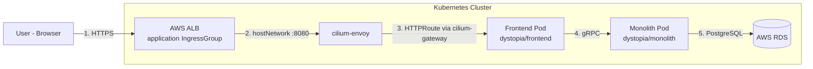
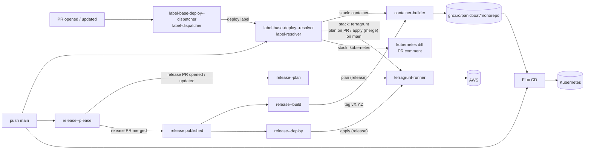

# Monorepo

[🇺🇸 English](README.md) | **日本語**

## 📖 Overview

## 📂 Structure

```
.
├── .github/workflows/        # CI ワークフロー（label base deploy / release / reusable builders）
├── clusters/{environment}/   # Flux CD ソース（Kustomization / ImagePolicy）
├── docs/                     # アーキテクチャ・アクセスポリシー
├── proto/{product}/          # product 内のサービス間で共有する gRPC コントラクト
└── {product}/
    └── {service}/
        ├── infrastructure/   # Terragrunt stack
        ├── kubernetes/       # Kustomize base / overlays
        └── README.md         # サービス固有のドキュメント
```

## 🛠 Prerequisites

クラスタの bootstrap、共通プラットフォームコンポーネント、CI が assume する OIDC IAM は [panicboat/platform](https://github.com/panicboat/platform/tree/main/kubernetes) で構成する。本リポジトリからクラスタを操作する前に platform 側を立ち上げておく。

## 🏗 Architecture



サービス内部のアーキテクチャは各 `dystopia/<service>/README.md` および [dystopia/docs](dystopia/docs/README.md) を参照する。

## 🚢 Deployment

PR ラベルおよび `main` への push を起点とした CI が GHCR にコンテナイメージを push し、Flux がそれをクラスタに反映する。release-please がサービスごとのバージョニングを担っているため、production のデプロイは moving tag ではなく semver tag に固定される。

### Pipeline Flow



### Mechanics

#### Trigger

| Event | Workflow | Action |
| --- | --- | --- |
| PR に `deploy:{service}` ラベルが付く | [label-base-deploy--resolver.yaml](.github/workflows/label-base-deploy--resolver.yaml) | すべての `terragrunt` target を plan し、コンテナイメージをビルドし、kustomize diff をコメントする |
| `main` への push | [label-base-deploy--resolver.yaml](.github/workflows/label-base-deploy--resolver.yaml) | `apply_trigger: merge` の `terragrunt` target を apply し、コンテナイメージをビルドする |
| release PR の作成・更新 | [release--plan.yaml](.github/workflows/release--plan.yaml) | その service の `apply_trigger: release` の environment を plan する |
| release の公開 | [release--build.yaml](.github/workflows/release--build.yaml) | コンテナイメージをビルドし、`vX.Y.Z` の tag を付ける |
| release の公開 | [release--deploy.yaml](.github/workflows/release--deploy.yaml) | その service の `apply_trigger: release` の environment を apply する |

##### Targets

- [label-base-deploy--dispatcher.yaml](.github/workflows/label-base-deploy--dispatcher.yaml) が PR の更新ごとに [label-dispatcher](https://github.com/panicboat/deploy-actions/tree/main/label-dispatcher) を実行し、差分が触れたサービスごとに `deploy:{service}` ラベルを PR に付ける。
- [label-base-deploy--resolver.yaml](.github/workflows/label-base-deploy--resolver.yaml) が PR へのラベル付与と `main` への push で起動する。[label-resolver](https://github.com/panicboat/deploy-actions/tree/main/label-resolver) が [workflow-config.yaml](workflow-config.yaml) の `stacks` を読み、ラベルをデプロイ対象に変換する。
- 各デプロイ対象は、その stack の reusable workflow に渡される。
- `terragrunt` stack の `exclude` に一致する `{service}/{environment}` の組は、release も含めて plan も apply もされない。
  - `environment` だけの rule はすべての service に効く。

##### Releases

- `apply_trigger: release` の environment ディレクトリを持つ service は、それぞれ release-please の設定（`release-please-config.json` / `release-please-manifest.json`）を持つ。
  - 設定がないと [check-release-configs.sh](.github/scripts/terragrunt-release/check-release-configs.sh) が CI を失敗させる。
- `apply_trigger: merge` の environment ディレクトリだけを変える commit は、release を作らない（`exclude-paths`）。
- `apply_trigger: release` の environment ディレクトリを持たない service（例: [dystopia/frontend](dystopia/frontend)）は `terragrunt` の target がないため、`Release - Plan` と `Release - Deploy` は skip される。`Release - Build` はイメージをビルドする。
- `apply_trigger: release` の environment がすべて除外されている間も release PR は作られるが、plan も apply もされない。
- plan を出し直すときは、`Release - Plan` の run で「Re-run all jobs」を使う。
- apply を再実行するときは、`gh workflow run release--deploy.yaml --ref {service}-vX.Y.Z -f tag={service}-vX.Y.Z` を実行する。

#### Stacks

各 stack が対象とするパスは [workflow-config.yaml](workflow-config.yaml) の `stacks` で定義している。

| Stack | Workflow | PR | `main` への push | release の公開 |
| --- | --- | --- | --- | --- |
| `container` | [reusable--container-builder.yaml](.github/workflows/reusable--container-builder.yaml) | ビルドして GHCR に push | ビルドして GHCR に push | ビルドして `vX.Y.Z` の tag で GHCR に push |
| `terragrunt` | [reusable--terragrunt-runner.yaml](.github/workflows/reusable--terragrunt-runner.yaml) | `terragrunt plan` | `apply_trigger: merge` の environment を `terragrunt apply` | `apply_trigger: release` の environment を `terragrunt apply` |
| `kubernetes` | [reusable--kubernetes-builder.yaml](.github/workflows/reusable--kubernetes-builder.yaml) | kustomize diff を PR にコメント | 何もしない。apply は Flux が行い、CI は `kubectl apply` を実行しない | 何もしない |

`terragrunt` stack の environment は、それぞれ `apply_trigger` を持つ。`merge` は `main` への push で apply し、`release` は service の release が公開されたときに apply する。

#### Versioning

1. [release--please.yaml](.github/workflows/release--please.yaml) が `release-please-config.json`（例: [dystopia/monolith/release-please-config.json](dystopia/monolith/release-please-config.json)）ごとに release-please を実行し、サービスごとに release PR を起票する。
2. release PR をマージすると、release `{service}-vX.Y.Z` が公開される。
3. [release--build.yaml](.github/workflows/release--build.yaml) がその release のコンテナをビルドし、イメージに `vX.Y.Z` の tag を付ける。
4. [release--deploy.yaml](.github/workflows/release--deploy.yaml) がその service の `apply_trigger: release` の environment を apply する。

#### GitOps

各サービスは `clusters/<environment>/` 配下にディレクトリを持つ（例: [clusters/production/dystopia/monolith](clusters/production/dystopia/monolith)）。

- [image-policy.yaml](clusters/production/dystopia/monolith/image-policy.yaml) が GHCR から最も新しい `vX.Y.Z` の tag を選ぶ。
- [image-automation.yaml](clusters/production/dystopia/monolith/image-automation.yaml) がその tag をサービスの overlay（例: [dystopia/monolith/kubernetes/overlays/production](dystopia/monolith/kubernetes/overlays/production)）にコミットする。クラスタで動いているものとリポジトリにあるものが一致する。

### Related Repositories

- [panicboat/platform](https://github.com/panicboat/platform) — クラスタ bootstrap、共通コンポーネント、OIDC IAM。
- [panicboat/deploy-actions](https://github.com/panicboat/deploy-actions) — PR の変更をデプロイ用ラベルに、ラベルをデプロイ対象に変換する GitHub Actions。
