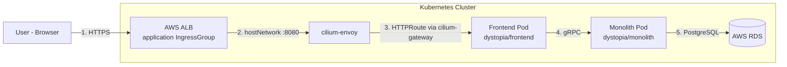
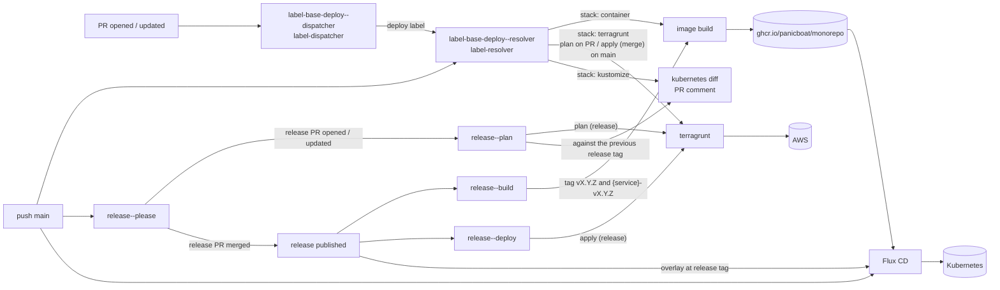

# Monorepo

[🇺🇸 English](README.md) | **日本語**

## 📖 Overview

## 📂 Structure

```
.
├── .github/workflows/        # CI ワークフロー（label base deploy / release）
├── clusters/{environment}/   # Flux CD ソース（Kustomization / ImagePolicy）
├── docs/                     # アーキテクチャ・アクセスポリシー
├── proto/{product}/          # product 内のサービス間で共有する gRPC コントラクト
└── {product}/
    └── {service}/
        ├── infrastructure/   # Terragrunt stack
        ├── kubernetes/       # Kustomize base / overlays
        └── README.md         # サービス固有のドキュメント
```

## 🛠 Prerequisites

クラスタの bootstrap、共通プラットフォームコンポーネント、CI が assume する OIDC IAM は [panicboat/platform](https://github.com/panicboat/platform/tree/main/kubernetes) で構成する。本リポジトリからクラスタを操作する前に platform 側を立ち上げておく。

## 🏗 Architecture



サービス内部のアーキテクチャは各 `dystopia/<service>/README.md` および [dystopia/docs](dystopia/docs/README.md) を参照する。

## 🚢 Deployment

PR ラベルおよび `main` への push を起点とした CI が GHCR にコンテナイメージを push し、Flux が各サービスの Kubernetes マニフェストを release tag から適用して、クラスタは対応するイメージを GHCR から pull する。release-please がサービスごとのバージョニングを担っているため、production のデプロイは moving tag ではなく semver tag に固定される。

### Pipeline Flow



### Mechanics

#### Trigger

| Event | Workflow | Action |
| --- | --- | --- |
| PR に `deploy:{service}` ラベルが付く | [label-base-deploy--resolver.yaml](.github/workflows/label-base-deploy--resolver.yaml) | すべての `terragrunt` target を plan し、コンテナイメージをビルドし、kustomize diff をコメントする |
| `main` への push | [label-base-deploy--resolver.yaml](.github/workflows/label-base-deploy--resolver.yaml) | `production` 以外の environment の `terragrunt` target を apply し、コンテナイメージをビルドする |
| release PR の作成・更新 | [release--plan.yaml](.github/workflows/release--plan.yaml) | その service の production の environment を plan し、production の overlay の前回の release tag との kustomize diff を投稿する |
| release の公開 | [release--build.yaml](.github/workflows/release--build.yaml) | コンテナイメージをビルドし、`vX.Y.Z` と `{service}-vX.Y.Z` の tag を付ける |
| release の公開 | [release--deploy.yaml](.github/workflows/release--deploy.yaml) | その service の production の environment を apply する |

##### Targets

- [label-base-deploy--dispatcher.yaml](.github/workflows/label-base-deploy--dispatcher.yaml) が PR の更新ごとに [label-dispatcher](https://github.com/panicboat/deploy-actions/tree/main/label-dispatcher) を実行し、差分が触れたサービスごとに `deploy:{service}` ラベルを PR に付ける。
- [label-base-deploy--resolver.yaml](.github/workflows/label-base-deploy--resolver.yaml) が PR へのラベル付与と `main` への push で起動する。[label-resolver](https://github.com/panicboat/deploy-actions/tree/main/label-resolver) が [workflow-config.yaml](workflow-config.yaml) の `stacks` を読み、ラベルをデプロイ対象に変換する。
- 各デプロイ対象は、その stack の reusable workflow に渡される。
- `terragrunt` stack の `exclude` に一致する `{service}/{environment}` の組は、release も含めて plan も apply もされない。
  - `environment` だけの rule はすべての service に効く。

##### Releases

- production の environment ディレクトリを持つ service は、それぞれ release-please の設定（`release-please-config.json` / `release-please-manifest.json`）を持つ。
  - 設定がないと [test-terragrunt-release.yaml](.github/workflows/test-terragrunt-release.yaml) が CI を失敗させる。
- production 以外の environment ディレクトリだけを変える commit は、release を作らない（`exclude-paths`）。
- production の environment ディレクトリを持たない service（例: [dystopia/frontend](dystopia/frontend)）は `terragrunt` の target がないため、`Release - Plan` は何も plan せず、`Release - Deploy` は skip される。`Release - Build` はイメージをビルドする。
- `Release - Plan` は、その service の production の overlay について、前回の release tag との kustomize diff を投稿する。release PR を merge したときに cluster に入る変更である。
  - 前回の release がない service には diff を出さない。
- production の environment が除外されている間も release PR は作られるが、plan も apply もされない。
- plan を出し直すときは、`Release - Plan` の run で「Re-run all jobs」を使う。
- apply を再実行するときは、`gh workflow run release--deploy.yaml --ref {service}-vX.Y.Z -f tag={service}-vX.Y.Z` を実行する。

#### Stacks

各 stack が対象とするパスは [workflow-config.yaml](workflow-config.yaml) の `stacks` で定義している。

| Stack | PR | `main` への push | release の公開 |
| --- | --- | --- | --- |
| `container` | ビルドして GHCR に push | ビルドして GHCR に push | ビルドして `vX.Y.Z` と `{service}-vX.Y.Z` の tag で GHCR に push |
| `terragrunt` | `terragrunt plan` | `production` 以外の environment を `terragrunt apply` | production の environment を `terragrunt apply` |
| `kustomize` | kustomize diff を PR にコメント。`main` と比べる（release PR では前回の release tag と比べる） | 何もしない。CI は `kubectl apply` を実行せず、Flux は `main` の overlay を release されるまで apply しない | Flux が release tag の overlay を apply する |

`terragrunt` stack は、名前が `production` の environment を service の release が公開されたときに apply し、それ以外の environment を `main` への push で apply する。

#### Versioning

1. [release--please.yaml](.github/workflows/release--please.yaml) が `release-please-config.json`（例: [dystopia/monolith/release-please-config.json](dystopia/monolith/release-please-config.json)）ごとに release-please を実行し、サービスごとに release PR を起票する。
   - release PR は、サービスの production overlay の `image:` 行も新しいバージョンに書き換える。
     - 書き換える行は、設定の `extra-files` に列挙したファイルにある `# x-release-please-version` の目印が付いた行である。
2. release PR をマージすると、release `{service}-vX.Y.Z` が公開される。
3. [release--build.yaml](.github/workflows/release--build.yaml) がその release のコンテナをビルドし、イメージに `vX.Y.Z` と `{service}-vX.Y.Z` の tag を付ける。
4. [release--deploy.yaml](.github/workflows/release--deploy.yaml) がその service の production の environment を apply する。
5. Flux が `{service}-vX.Y.Z` のイメージ tag を見つけ、サービスをその release tag のマニフェストに切り替える（[GitOps](#gitops) を参照）。

#### GitOps

各サービスは `clusters/<environment>/` 配下にディレクトリを持つ（例: [clusters/production/dystopia/monolith](clusters/production/dystopia/monolith)）。

- [service.yaml](clusters/production/dystopia/monolith/service.yaml) が GitRepository `monorepo-{service}` と Kustomization `{service}` を定義する。
  - Kustomization は、GitRepository の `ref.tag` にある tag の snapshot からサービスの overlay（例: [dystopia/monolith/kubernetes/overlays/production](dystopia/monolith/kubernetes/overlays/production)）を apply する。
  - `main` の overlay への変更は、そのサービスの次の release でクラスタに届く。
- [image-policy.yaml](clusters/production/dystopia/monolith/image-policy.yaml) が GHCR から最も新しい `{service}-vX.Y.Z` の tag を選ぶ。
- [image-automation.yaml](clusters/production/dystopia/monolith/image-automation.yaml) がその tag を `service.yaml` の `ref.tag` に書き込み、commit を `main` に push する。
  - Flux は GHCR にイメージが置かれた後にしか tag に気付かないため、イメージがない状態でマニフェストが切り替わることはない。
    - これは自動の経路でのみ成り立つため、手で書き換える `ref.tag` には、`{service}-vX.Y.Z` のイメージが既に GHCR にある release tag を指定する。
- overlay の `image:` 行は release PR で release-please が書き換えるので、`ref.tag` と同じ release を指す。

##### Rollback

1. `service.yaml` の `ref.tag` を一つ前の release tag に戻す PR をマージする。
2. 同じ PR で `image-automation.yaml` の `spec.suspend: true` を設定する。
   - image-policy は最新の tag を選び続けるため、`suspend` がないと image-automation が次の実行で `ref.tag` を最新に戻してしまう。
3. 次の release の `{service}-vX.Y.Z` のイメージが GHCR に置かれた後に、別の PR で `suspend: true` を外す。
   - それまで image-policy は最新の tag、つまり戻す前の tag を選び続けるため、先に `suspend` を外すと `ref.tag` に書き戻される。
   - イメージの有無は `flux get image policy {service}` か GHCR の tag 一覧で確認する。
   - release-please が release PR のブランチを書き換えるため、この変更を release PR には足さない。

### Related Repositories

- [panicboat/platform](https://github.com/panicboat/platform) — クラスタ bootstrap、共通コンポーネント、OIDC IAM。
- [panicboat/deploy-actions](https://github.com/panicboat/deploy-actions) — PR の変更をデプロイ用ラベルに、ラベルをデプロイ対象に変換する GitHub Actions。
