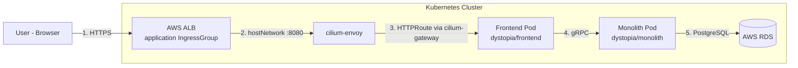
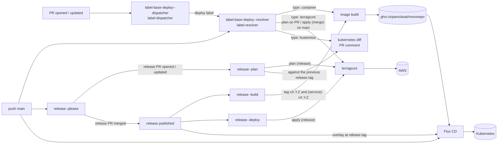

# Monorepo

**English** | [🇯🇵 日本語](README-ja.md)

## 📖 Overview

## 📂 Structure

```
.
├── .github/workflows/        # CI: label base deploy, release
├── clusters/{environment}/   # Flux CD sources (Kustomization, ImagePolicy)
├── docs/                     # Architecture & access policy
├── proto/{product}/          # gRPC contracts shared between the product's services
└── {product}/
    └── {service}/
        ├── infrastructure/   # Terragrunt stacks
        ├── kubernetes/       # Kustomize base & overlays
        └── README.md         # Service-specific notes
```

## 🛠 Prerequisites

Cluster bootstrap, shared platform components, and the OIDC IAM that CI assumes live in [panicboat/platform](https://github.com/panicboat/platform/tree/main/kubernetes). Bring up the platform before targeting the cluster from this repo.

## 🏗 Architecture



Service-internal architecture is documented in each `dystopia/<service>/README.md` and in [dystopia/docs](dystopia/docs/README.md).

## 🚢 Deployment

A PR-label / push-driven CI pipeline produces container images; Flux applies each service's Kubernetes manifests from its release tag, and the cluster pulls the matching image from GHCR. release-please owns service versioning, so a production deploy is pinned to a semver tag rather than to a moving target.

### Pipeline Flow



### Mechanics

#### Trigger

| Event | Workflow | Action |
| --- | --- | --- |
| `deploy:{service}` label added to a PR | [label-base-deploy--resolver.yaml](.github/workflows/label-base-deploy--resolver.yaml) | Plan every `terragrunt` target, build the container image, and post the kustomize diff |
| Push to `main` | [label-base-deploy--resolver.yaml](.github/workflows/label-base-deploy--resolver.yaml) | Apply non-production `terragrunt` targets and build the container image |
| Release PR opened / updated | [release--plan.yaml](.github/workflows/release--plan.yaml) | Plan the service's production environment and post the kustomize diff of its production overlay against the previous release tag |
| Release published | [release--build.yaml](.github/workflows/release--build.yaml) | Build the container image and tag it `vX.Y.Z` and `{service}-vX.Y.Z` |
| Release published | [release--deploy.yaml](.github/workflows/release--deploy.yaml) | Apply the service's production environment |

##### Targets

- [label-base-deploy--dispatcher.yaml](.github/workflows/label-base-deploy--dispatcher.yaml) runs [label-dispatcher](https://github.com/panicboat/deploy-actions/tree/main/label-dispatcher) on every PR update and puts a `deploy:{service}` label on the PR for each service the diff touches.
- [label-base-deploy--resolver.yaml](.github/workflows/label-base-deploy--resolver.yaml) runs when a PR is labeled and on every push to `main`. [label-resolver](https://github.com/panicboat/deploy-actions/tree/main/label-resolver) reads `services[].stacks` in [workflow-config.yaml](workflow-config.yaml) and turns the labels into deploy targets.
- Each target goes to the reusable workflow for its `type` attribute.
- A `{service}/{environment}` pair matched by `exclude` of the `aws` stack (`type: terragrunt`) is never planned or applied, including by releases.
  - A rule with only `environment` covers every service.

##### Releases

- Each service that has a production environment directory has its own release-please config (`release-please-config.json` / `release-please-manifest.json`).
- Commits that touch non-production environment directories count as changes to the service's release-please package.
- A service with no production environment directory has no `terragrunt` target, so `Release - Plan` plans nothing and `Release - Deploy` skips it. `Release - Build` still builds its image.
- `Release - Plan` posts the kustomize diff of the service's production overlay against the previous release tag, which is what merging the release PR brings to the cluster.
  - A service with no previous release gets no diff.
- While the production environment is excluded, the release PR is still created, but nothing is planned or applied.
- To re-plan, use "Re-run all jobs" on the `Release - Plan` run.
- To re-apply, run `gh workflow run release--deploy.yaml --ref {service}-vX.Y.Z -f tag={service}-vX.Y.Z`.

#### Types

The paths each stack covers are defined in `services[].stacks` in [workflow-config.yaml](workflow-config.yaml). The `type` attribute of a stack (`container`, `terragrunt`, `kustomize`) selects what runs.

| Type | On a PR | On push to `main` | On release published |
| --- | --- | --- | --- |
| `container` | Build and push to GHCR | Build and push to GHCR | Build and push to GHCR, tagged `vX.Y.Z` and `{service}-vX.Y.Z` |
| `terragrunt` | `terragrunt plan` | `terragrunt apply` of non-production environments | `terragrunt apply` of the production environment |
| `kustomize` | Kustomize diff as a PR comment, against `main` (against the previous release tag on a release PR) | Nothing. CI never runs `kubectl apply`, and Flux does not apply the overlay on `main` until it is released | Flux applies the overlay at the release tag |

The `terragrunt` type applies the environment named `production` when the service release is published, and every other environment on push to `main`.

#### Versioning

1. [release--please.yaml](.github/workflows/release--please.yaml) runs release-please once for every `release-please-config.json` (e.g. [dystopia/monolith/release-please-config.json](dystopia/monolith/release-please-config.json)) and raises one release PR per service.
   - The release PR also rewrites the `image:` lines of the service's production overlay to the new version.
     - The lines to rewrite are the ones marked `# x-release-please-version` in the files listed in `extra-files` of the config.
2. Merging a release PR publishes the release `{service}-vX.Y.Z`.
3. [release--build.yaml](.github/workflows/release--build.yaml) builds the container for that release and tags the image `vX.Y.Z` and `{service}-vX.Y.Z`.
4. [release--deploy.yaml](.github/workflows/release--deploy.yaml) applies the service's production environment.
5. Flux finds the `{service}-vX.Y.Z` image tag and switches the service to the manifests at that release tag (see [GitOps](#gitops)).

#### GitOps

Each service has a directory under `clusters/<environment>/` (e.g. [clusters/production/dystopia/monolith](clusters/production/dystopia/monolith)).

- [service.yaml](clusters/production/dystopia/monolith/service.yaml) defines the GitRepository `monorepo-{service}` and the Kustomization `{service}`.
  - The Kustomization applies the service's overlay (e.g. [dystopia/monolith/kubernetes/overlays/production](dystopia/monolith/kubernetes/overlays/production)) from the snapshot of the tag in `ref.tag` of the GitRepository.
  - A change to the overlay on `main` reaches the cluster with the next release of the service.
- [image-policy.yaml](clusters/production/dystopia/monolith/image-policy.yaml) selects the highest `{service}-vX.Y.Z` tag on GHCR.
- [image-automation.yaml](clusters/production/dystopia/monolith/image-automation.yaml) writes that tag into `ref.tag` of `service.yaml` and pushes the commit to `main`.
  - Flux notices a tag only after its image is on GHCR, so the manifests are never switched before the image exists.
    - This holds only on the automated path, so a hand-written `ref.tag` must point at a release tag whose `{service}-vX.Y.Z` image is already on GHCR.
- The `image:` lines of the overlay are written by release-please in the release PR, so they name the same release as `ref.tag`.

##### Rollback

1. Merge a PR that sets `ref.tag` in `service.yaml` back to the previous release tag.
2. Set `spec.suspend: true` in `image-automation.yaml` in the same PR.
   - image-policy still selects the newest tag, so without `suspend` image-automation moves `ref.tag` forward again on its next run.
3. Remove `suspend: true` in a separate PR once the `{service}-vX.Y.Z` image of the next release is on GHCR.
   - Until then image-policy keeps selecting the newest tag, the one rolled back from, so removing `suspend` earlier writes it back into `ref.tag`.
   - Check the image with `flux get image policy {service}` or the GHCR tag list.
   - Do not add the change to the release PR, because release-please rewrites its branch.

### Related Repositories

- [panicboat/platform](https://github.com/panicboat/platform) — cluster bootstrap, shared components, OIDC IAM.
- [panicboat/deploy-actions](https://github.com/panicboat/deploy-actions) — GitHub Actions that turn the changes in a PR into deploy labels and the labels into deploy targets.
