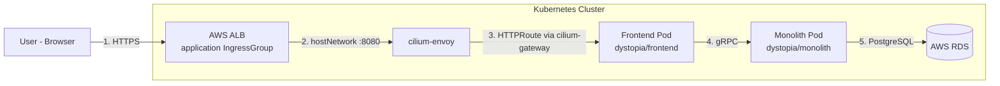
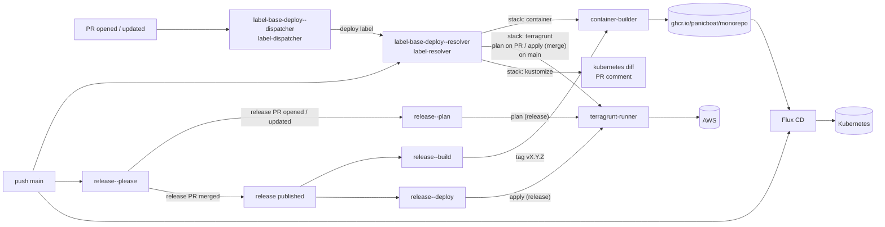

# Monorepo

**English** | [🇯🇵 日本語](README-ja.md)

## 📖 Overview

## 📂 Structure

```
.
├── .github/workflows/        # CI: label base deploy, release
├── clusters/{environment}/   # Flux CD sources (Kustomization, ImagePolicy)
├── docs/                     # Architecture & access policy
├── proto/{product}/          # gRPC contracts shared between the product's services
└── {product}/
    └── {service}/
        ├── infrastructure/   # Terragrunt stacks
        ├── kubernetes/       # Kustomize base & overlays
        └── README.md         # Service-specific notes
```

## 🛠 Prerequisites

Cluster bootstrap, shared platform components, and the OIDC IAM that CI assumes live in [panicboat/platform](https://github.com/panicboat/platform/tree/main/kubernetes). Bring up the platform before targeting the cluster from this repo.

## 🏗 Architecture



Service-internal architecture is documented in each `dystopia/<service>/README.md` and in [dystopia/docs](dystopia/docs/README.md).

## 🚢 Deployment

A PR-label / push-driven CI pipeline produces container images; Flux pulls them from GHCR into the cluster. release-please owns service versioning, so a production deploy is pinned to a semver tag rather than to a moving target.

### Pipeline Flow



### Mechanics

#### Trigger

| Event | Workflow | Action |
| --- | --- | --- |
| `deploy:{service}` label added to a PR | [label-base-deploy--resolver.yaml](.github/workflows/label-base-deploy--resolver.yaml) | Plan every `terragrunt` target, build the container image, and post the kustomize diff |
| Push to `main` | [label-base-deploy--resolver.yaml](.github/workflows/label-base-deploy--resolver.yaml) | Apply `terragrunt` targets with `apply_trigger: merge` and build the container image |
| Release PR opened / updated | [release--plan.yaml](.github/workflows/release--plan.yaml) | Plan the service's `apply_trigger: release` environments |
| Release published | [release--build.yaml](.github/workflows/release--build.yaml) | Build the container image and tag it `vX.Y.Z` |
| Release published | [release--deploy.yaml](.github/workflows/release--deploy.yaml) | Apply the service's `apply_trigger: release` environments |

##### Targets

- [label-base-deploy--dispatcher.yaml](.github/workflows/label-base-deploy--dispatcher.yaml) runs [label-dispatcher](https://github.com/panicboat/deploy-actions/tree/main/label-dispatcher) on every PR update and puts a `deploy:{service}` label on the PR for each service the diff touches.
- [label-base-deploy--resolver.yaml](.github/workflows/label-base-deploy--resolver.yaml) runs when a PR is labeled and on every push to `main`. [label-resolver](https://github.com/panicboat/deploy-actions/tree/main/label-resolver) reads `stacks` in [workflow-config.yaml](workflow-config.yaml) and turns the labels into deploy targets.
- Each target goes to the reusable workflow of its stack.
- A `{service}/{environment}` pair matched by `exclude` of the `terragrunt` stack is never planned or applied, including by releases.
  - A rule with only `environment` covers every service.

##### Releases

- Each service that has an `apply_trigger: release` environment directory has its own release-please config (`release-please-config.json` / `release-please-manifest.json`).
  - [check-release-configs.sh](https://github.com/panicboat/.github/blob/main/scripts/terragrunt-release/check-release-configs.sh) fails CI when a config is missing.
- Commits that touch only `apply_trigger: merge` environment directories do not create a release (`exclude-paths`).
- A service with no `apply_trigger: release` environment directory, such as [dystopia/frontend](dystopia/frontend), has no `terragrunt` target, so `Release - Plan` and `Release - Deploy` skip it. `Release - Build` still builds its image.
- While every `apply_trigger: release` environment is excluded, the release PR is still created, but nothing is planned or applied.
- To re-plan, use "Re-run all jobs" on the `Release - Plan` run.
- To re-apply, run `gh workflow run release--deploy.yaml --ref {service}-vX.Y.Z -f tag={service}-vX.Y.Z`.

#### Stacks

The paths each stack covers are defined in `stacks` in [workflow-config.yaml](workflow-config.yaml).

| Stack | Workflow | On a PR | On push to `main` | On release published |
| --- | --- | --- | --- | --- |
| `container` | [reusable--container-builder.yaml](https://github.com/panicboat/.github/blob/main/.github/workflows/reusable--container-builder.yaml) | Build and push to GHCR | Build and push to GHCR | Build and push to GHCR, tagged `vX.Y.Z` |
| `terragrunt` | [reusable--terragrunt-runner.yaml](https://github.com/panicboat/.github/blob/main/.github/workflows/reusable--terragrunt-runner.yaml) | `terragrunt plan` | `terragrunt apply` of `apply_trigger: merge` environments | `terragrunt apply` of `apply_trigger: release` environments |
| `kustomize` | [reusable--kubernetes-builder.yaml](https://github.com/panicboat/.github/blob/main/.github/workflows/reusable--kubernetes-builder.yaml) | Kustomize diff as a PR comment | Nothing. Flux applies; CI never runs `kubectl apply` | Nothing |

Each environment of the `terragrunt` stack sets `apply_trigger`: `merge` applies on push to `main`, `release` applies when the service release is published.

#### Versioning

1. [release--please.yaml](.github/workflows/release--please.yaml) runs release-please once for every `release-please-config.json` (e.g. [dystopia/monolith/release-please-config.json](dystopia/monolith/release-please-config.json)) and raises one release PR per service.
2. Merging a release PR publishes the release `{service}-vX.Y.Z`.
3. [release--build.yaml](.github/workflows/release--build.yaml) builds the container for that release and tags the image `vX.Y.Z`.
4. [release--deploy.yaml](.github/workflows/release--deploy.yaml) applies the service's `apply_trigger: release` environments.

#### GitOps

Each service has a directory under `clusters/<environment>/` (e.g. [clusters/production/dystopia/monolith](clusters/production/dystopia/monolith)).

- [image-policy.yaml](clusters/production/dystopia/monolith/image-policy.yaml) selects the highest `vX.Y.Z` tag on GHCR.
- [image-automation.yaml](clusters/production/dystopia/monolith/image-automation.yaml) commits that tag into the service's overlay (e.g. [dystopia/monolith/kubernetes/overlays/production](dystopia/monolith/kubernetes/overlays/production)), so what runs in the cluster is what is checked in.

### Related Repositories

- [panicboat/platform](https://github.com/panicboat/platform) — cluster bootstrap, shared components, OIDC IAM.
- [panicboat/deploy-actions](https://github.com/panicboat/deploy-actions) — GitHub Actions that turn the changes in a PR into deploy labels and the labels into deploy targets.
