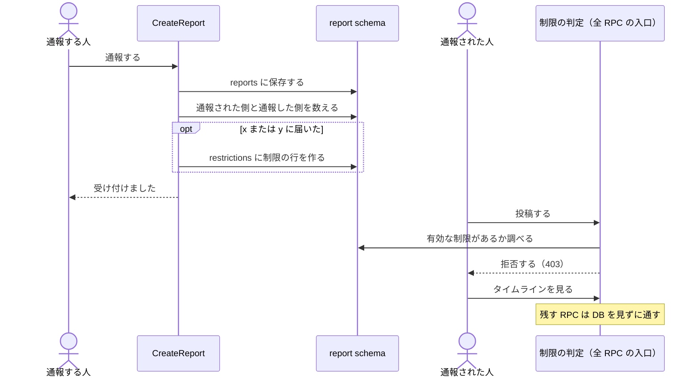
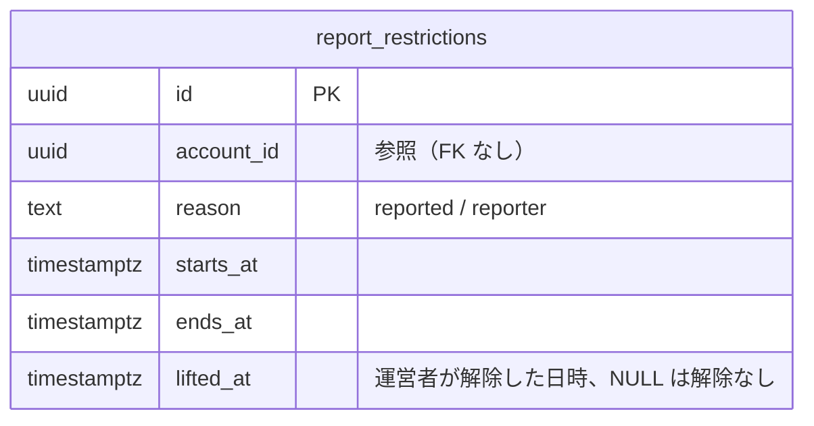

# Dystopia Report Restriction Design

Issue: [#1926](https://github.com/panicboat/monorepo/issues/1926)
前提: [#1924](https://github.com/panicboat/monorepo/pull/1924)（通報を貯める機能）

## Intent

悪意のあるユーザーの粘着や、短時間に通報を繰り返す行動を、運営者の巡回を待たずに止める。
夜職の人にとって安心して使える場所であることを守るための、一時的な制限である。

## Goals

- 24 時間以内に x 人から通報された人が、一定期間、見るだけになる。
  - 通報した人はアカウントで数えるので、複数のプロフィールを持っていても 1 人である。
- 24 時間以内に y 個のプロフィールを通報した人が、一定期間、見るだけになる。
- 粘着の被害者が同じ相手を何度通報しても、本人は制限されず、証拠は残る。
- 制限は、繰り返すほど長くなる。
- 誤った制限は、運営者の連絡先に申し出ると、運営者が SQL で解除できる。

## Non-goals

- 通報の内容の自動判定。
- 投稿の自動非表示。
- 電話番号ごとの永久 BAN。
- 異議申し立ての画面と、運営者の管理画面。
- 被害者が 1 人だけの粘着を自動で止めること。
  - 被害者 1 人の通報では x に届かないので、運営者が通報を読んで対応する。

## Anti-goals

- 粘着する人が、1 人で相手を黙らせられる仕組みにしない。
- 粘着された人が、通報したせいで制限される仕組みにしない。
- 制限された人が、ブロックと退会までできなくなる状態を作らない。
- 制限が重すぎて、普通の利用者が離れていく状態を作らない。

## Constraints

- 通報の内容は誰も確認しないので、知り合い x 人で組めば 1 人を制限の間止められる。
  - 防ぐ手段は x の値だけである。
- 制限中は通報もできない（`CreateReport` を拒否する）。
  - 制限中に被害を受けても、解けるまでは運営者の連絡先に申し出るしかない。
- デプロイは migrate → アプリ更新の順である。

## Decisions

### Flow

### Counting

通報の行は #1924 の `report.reports` をそのまま数える。

- 通報された側: `reported_account_id` が同じ行の、直近 24 時間の `reporter_account_id` の異なり数が x 以上。
- 通報した側: `reporter_account_id` が同じ行の、直近 24 時間の `reported_profile_id` の異なり数が y 以上。

異なり数で数えるので、同じ相手への 2 回目以降の通報は自動で数に入らない。
#1924 は対象が別の投稿や DM なら行を増やすので、証拠の保存に変更は要らない。
`reported_profile_id` が NULL の行（送信者が削除済みの DM）は、通報した側の数に入らない。

y をプロフィールで数えるのは、プロフィールとアカウントの関係が公開されていないからである。
通報する人から見ると、持ち主が同じプロフィールも別々の相手である。
キャストは 5 つまでプロフィールを持てるので、y は 6 以上にする。
5 以下だと、1 人に粘着された人が、その人の各プロフィールを通報するだけで制限される。

### Restriction storage

判定の方法は、次の 2 案を比べて、制限の行を保存する案にする。

| 案 | 良い点 | 問題 |
| --- | --- | --- |
| **制限の行を保存する（採用）** | 必ず決めた長さだけ続く 履歴が残る SQL で解除できる | テーブルが 1 つ増える |
| 書き込みのたびに通報を数える | テーブルが増えない | 古い通報が窓から外れると決めた長さより早く解ける 解除の手段がない 書き込みのたびに集計が走る |

`report.restrictions` を追加する。

- 判定は `account_id` と `ends_at` で引くので、この組に索引を張る。
- `lifted_at` のある行は、有効な制限として扱わない。
- `report.reports` には、集計用に `(reported_account_id, created_at)` と `(reporter_account_id, created_at)` の索引を張る。
- 制限の行は、プロフィールやアカウントを消しても残す。
  - 通報と同じく、アカウント ID で辿るためである。

### Restriction length

制限の長さには段階を付ける。

- 1 回目は短くする。
  - 集団通報に巻き込まれた人も、ここに含まれるためである。
- 2 回目以降は長くする。
  - 繰り返す人は、巻き込まれた可能性が低いためである。
- 直近の一定期間に制限がなければ、1 回目の長さに戻す。
- 通報された側と通報した側で、長さは同じである。
- `lifted_at` のある行は回数に数えない。
  - 誤った制限を解除した人が、次に重い制限を受けないようにするためである。

### What the restricted person sees

制限された本人の画面に、利用を制限中であることと、解除の日時を出す。

- 理由は出さない。
  - 利用規約の「措置の理由を、原則として開示しません」に合わせるためである。
- 通知は送らない。
  - 画面を開けば分かるためである。

### Published content

公開済みの投稿と予定は、制限中も見せ続ける。

- 消すと、集団で通報するだけで投稿や予定まで消せてしまうためである。
- 粘着に使われた投稿も、運営者が対応するまで見えたままである。

### Enforcement

判定は `lib/interceptors/` の新しい interceptor に置き、`AuthenticationInterceptor` の内側で動かす。

- 制限中でも通してよい RPC の一覧を持ち、一覧にない RPC は拒否する。
  - RPC を足したときの漏れが、制限のかけ忘れにならないようにするためである。
- 一覧にある RPC は DB を見ずに通すので、読み取りの負荷は増えない。
- 拒否は `PERMISSION_DENIED` で、`error-reason` に `account_restricted` を入れる。
  - BFF の `handleApiError` が 403 と `code` に変換する既存の経路に乗る。
- spec で、proto の全 RPC が「通す」または「拒否する」に分類されていることを確かめる。
- `x-user-id` のないリクエストは判定しない。

### RPC classification

制限中に通す RPC は、次のとおりである。
一覧にない RPC はすべて拒否する。
`GetUploadUrl` と `GetOrCreateThread` は名前が `Get` で始まるが書き込みなので拒否する。
そのため一覧は名前の規則で作らず、RPC を 1 つずつ並べる。

| 種類 | RPC | 理由 |
| --- | --- | --- |
| 読み取り | 名前が `Get`、`List`、`Search`、`Rank`、`Suggest`、`Check` で始まる RPC と `HealthCheck`（`GetUploadUrl` と `GetOrCreateThread` を除く） | 閲覧 |
| ブロック | `Social.Block` | 身を守る手段を残す |
| 退会と復帰 | `DeactivateAccount`、`ReactivateAccount` | やめる権利を止めない 猶予中はログインで復帰する |
| 既読 | 通知、足跡、メッセージの `MarkRead`、`MarkAllRead` | 閲覧に付随する |
| 足跡 | `RecordVisit` | 閲覧に付随する |
| 通知の設定 | `UpdateNotificationPreferences`、`RegisterPushSubscription`、`UnregisterPushSubscription`、`ClaimPushEndpoint` | 自分の受け取り方だけに関わる |
| 登録 | `CreateAccount`、`ReleaseIncompleteSignUp` | 制限の前の段階である |
| 課金 | `CreateCustomerPortalSession` | 解約を止めない |

退会の前に制限された場合、退会と復帰をしても制限は解けない。
制限はアカウント ID に紐づくからである。

### Legal text

利用規約とプライバシーポリシーは変更しない。

- 通報が集中したことをもって、運営者が違反と判断する。
  - 判断の仕方を規約は限定していないので、「違反への措置」の「機能の一部の利用の制限」にあたる。
- 通報された側の根拠は、禁止事項の「誹謗中傷」「嫌がらせ」である。
- 短時間に通報を繰り返した側の根拠は、禁止事項の「嫌がらせ」「本サービスの運営を妨げること」である。
- 情報の利用は、プライバシーポリシーの「不正な利用と利用規約の違反に対応すること」に含まれる。
- この解釈について、弁護士の確認はしていない。

### Docs

- `dystopia/docs/features/reports.md` の「自動の処置は持たない」を、今回の制限に書き換える。
- `dystopia/docs/data-model.md` に `report.restrictions` を足す。
- `dystopia/docs/README.md` の「凍結しない」は変えない。
  - 永久の停止を持たないという記述で、一定期間の制限とは矛盾しないためである。

## Claude's calls

次はユーザーと話していない、Claude の判断である。

- 制限中に通す RPC を、`RPC classification` の表のとおりにした。
  - 通知の設定、足跡、既読、解約を残している。
  - 自分の投稿の削除、ブロックの解除、プロフィールの作成と削除は止める。
- 制限中に条件に当たっても、制限を延ばさない。
  - 制限中の通報も数に入るので、解けた後の次の通報で、もう一度制限されることがある。
- 運営者のアカウントも、例外にしない。
- 制限された本人に、解除の日時も見せる。
  - いつ解けるか分からないと、問い合わせと離脱が増えるためである。
- 同時に通報が届いて x に届くのが一瞬遅れる場合は、次の通報で制限されるので対策しない。

## Left to the builder

- 制限の判定に使う一覧の持ち方。
- x と y の定数を置く場所。
- 制限中の画面を、どの API で受け取るか。
- 一覧にない RPC を拒否したときの、各画面のトーストの出し方。

## Open questions

- 1 回目の長さ、2 回目以降の長さ、1 回目の長さに戻るまでの期間。
  - 24 時間では軽すぎる。
  - 案は 7 日、1 か月、半年である。
- x と y の値。
- 他の利用者から、制限中であることが分かるか。
