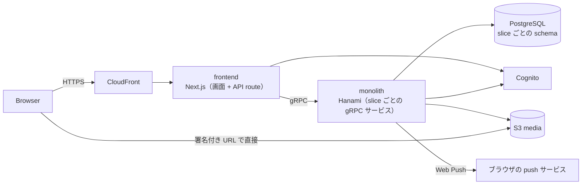

# dystopia

キャストとゲストが使う SNS。
キャストの集客の場と、問題のあるゲストからキャストを守る仕組み（カルテ・ブロック・足跡）を一つのサービスで提供する。

このディレクトリは、各機能が現在どう動くかを開発者向けにまとめたもの。

## Concept

- **凍結しない**: 運営の判断でアカウントを永久に停止する機構を持たない。
  - 投稿・フォロワー・プロフィールはキャストの資産として残る
    - ただし、退会すると他の利用者に見えなくなり、退会から 90 日後の削除処理で消える（[アカウント](features/account.md)）。
    - ただし、18 歳未満または高校生と分かった利用者は、規約に基づいて運営者が同じ削除処理で消す（[アカウント](features/account.md)）。
- **自己防衛**: キャストがゲストについて記録したカルテを、キャストの間で共有する
- **2 つのロール**: アカウントごとにキャストかゲストかが決まり、使える機能が分かれる（カルテはキャスト、クチコミはゲスト）

## Architecture

- frontend は画面と API route を持つ。
  - ブラウザは API route を呼び、API route が monolith の gRPC を呼ぶ
    - メディアの本体とサムネイルは、monolith が発行して API route が返す署名付き URL で S3 に直接アップロードし、S3 から直接読み込む
- monolith は 1 プロセスで全 slice の gRPC サービスを提供する。
  - slice ごとに proto のパッケージを持つ
  - アプリのテーブルは slice ごとの schema に置く
    - feed と discovery はテーブルを持たず、schema も作らない
- slice 間の連携は同じプロセス内の呼び出しで行う。
  - 呼び出し先は相手 slice の use case または repository。
    - 例外として、プロフィールの要約表示は相手 slice の ProfileSummaryPresenter を直接呼ぶ。
- DB の外部キーは slice をまたがない（[データモデル](data-model.md)）
- 本番は frontend と monolith を 1 つの Lambda コンテナに同居させて動かしている。
  - 構成と理由は [dystopia/lambda](../lambda/README.md) にある

## Glossary

| 用語 | 意味 |
|---|---|
| アカウント | ログインの単位。 電話番号とパスワードで認証する |
| プロフィール | アカウントが持つ人格。 キャストのアカウントは 5 つまで、ゲストのアカウントは 1 つまでプロフィールを持てる。 投稿・フォロー・カルテなどの主体はプロフィール |
| キャスト / ゲスト | アカウントのロール。 登録時に決まり、そのアカウントの全プロフィールに適用される |
| 予定 | キャストが店に出る予定。 日付は営業日で数え、05:00 より前は前日の営業日に属する |
| カルテ | キャストがゲストについて残す記録 |
| クチコミ | ゲストがキャストについて残す記録 |

## Slices

| slice | 役割 | 機能 |
|---|---|---|
| identity | アカウント、ロール、退会と復活、退会後の削除 | [アカウント](features/account.md) |
| profile | プロフィール、公開設定 | [プロフィール](features/profiles.md) |
| media | 画像と動画のアップロードと配信 | [メディア](features/media.md) |
| post | 投稿、いいね、コメント、メンション | [投稿](features/posts.md) |
| social | フォロー、フォロー承認、ブロック、投稿の閲覧可否 | [フォロー・ブロック](features/follows-and-blocks.md) |
| schedule | 予定、予定のお知らせ | [予定](features/schedules.md) |
| feed | ホームのフィード | [フィード・ランキング](features/feed-and-ranking.md) |
| discovery | 検索、ランキング、おすすめユーザー | [検索](features/search.md)、[フィード・ランキング](features/feed-and-ranking.md) |
| karte | カルテ | [カルテ](features/karte.md) |
| review | クチコミ | [クチコミ](features/reviews.md) |
| messaging | メッセージ | [メッセージ](features/messages.md) |
| notifications | 通知、通知設定、Web Push | [通知](features/notifications.md) |
| bookmarks | ブックマーク | [ブックマーク](features/bookmarks.md) |
| footprints | 足跡 | [足跡](features/footprints.md) |
| billing | 課金（未稼働） | [課金](features/billing.md) |
