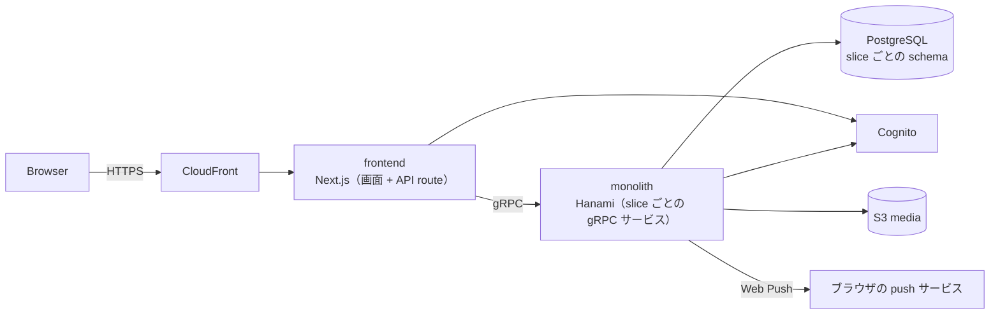

# dystopia

キャストとゲストが使う SNS。キャストの集客の場と、問題のあるゲストからキャストを守る仕組み（カルテ・ブロック・足あと）を一つのサービスで提供する。

このディレクトリは、各機能が現在どう動くかを開発者向けにまとめたもの。

## Concept

- **凍結しない**: 運営の判断でアカウントを永久に停止する機構を持たない。投稿・フォロワー・プロフィールはキャストの資産として残る
- **自己防衛**: キャストがゲストについて記録したカルテを、キャストの間で共有する
- **2 つのロール**: アカウントごとにキャストかゲストかが決まり、使える機能が分かれる（カルテはキャスト、クチコミはゲスト）

## Architecture

- frontend は画面と API route を持つ。ブラウザは API route だけを呼び、API route が monolith の gRPC を呼ぶ
- monolith は 1 プロセスで全 slice の gRPC サービスを提供する。slice ごとに proto のパッケージと DB の schema を持つ
- slice 間の連携は同じプロセス内の呼び出しで行う。呼び出し先は相手 slice の use case または repository。DB の外部キーは slice をまたがない（[データモデル](data-model.md)）
- 本番は frontend と monolith を 1 つの Lambda コンテナに同居させて動かしている。構成と理由は [dystopia/lambda](../lambda/README.md) にある

## Glossary

| 用語 | 意味 |
|---|---|
| アカウント | ログインの単位。電話番号とパスワードで認証する |
| プロフィール | アカウントが持つ人格。1 アカウントが複数持て、投稿・フォロー・カルテなどの主体はプロフィール |
| キャスト / ゲスト | アカウントのロール。登録時に決まり、そのアカウントの全プロフィールに適用される |
| 予定 | キャストが店に出る予定。日付は営業日で数え、05:00 より前は前日の営業日に属する |
| カルテ | キャストがゲストについて残す記録 |
| クチコミ | ゲストがキャストについて残す記録 |

## Slices

| slice | 役割 | 機能 |
|---|---|---|
| identity | アカウント、ロール、認証、セッション | [アカウント](features/account.md) |
| profile | プロフィール、公開設定 | [プロフィール](features/profiles.md) |
| media | 画像のアップロードと配信 | [メディア](features/media.md) |
| post | 投稿、いいね、コメント、メンション | [投稿](features/posts.md) |
| social | フォロー、フォロー承認、ブロック、投稿の閲覧可否 | [フォロー・ブロック](features/follows-and-blocks.md) |
| schedule | 予定、予定のお知らせ | [予定](features/schedules.md) |
| feed | ホームのフィード | [フィード・ランキング](features/feed-and-ranking.md) |
| discovery | 検索、ランキング、おすすめユーザー | [検索](features/search.md)、[フィード・ランキング](features/feed-and-ranking.md) |
| karte | カルテ | [カルテ](features/karte.md) |
| review | クチコミ | [クチコミ](features/reviews.md) |
| messaging | メッセージ | [メッセージ](features/messages.md) |
| notifications | 通知、通知設定、Web Push | [通知](features/notifications.md) |
| bookmarks | ブックマーク | [ブックマーク](features/bookmarks.md) |
| footprints | 足あと | [足あと](features/footprints.md) |
| billing | 課金（未稼働） | [課金](features/billing.md) |
