# データモデル

テーブルは slice ごとに PostgreSQL の schema（`identity`、`profile`、`post` など）へ分かれている。
slice をまたぐ参照（例: `post.posts.author_profile_id` → `profile.profiles.id`）は FK 制約を持たず、値の一致だけで結ぶ。
FK 制約があるのは同一 slice 内の親子関係（`post` の投稿とその子テーブル、`karte.events`、`review.events`）のみ。

## Overview

slice をまたぐ主要な参照を示す。
点線は FK 制約のない参照、ルートテーブルは account と profile。

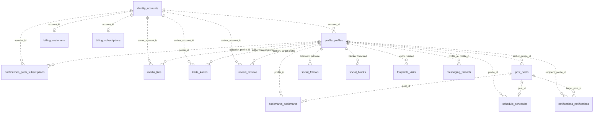

## Identity

アカウント（ログイン単位）の状態を持つ。

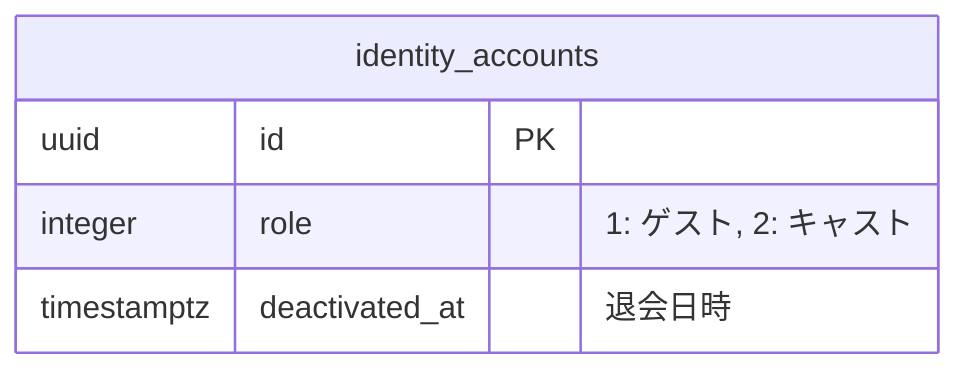

- `identity.accounts`: ログイン単位のアカウント。
  - ロールと退会日時を持つ。
  - 退会から 90 日を過ぎると削除処理で消える。

[アカウント](features/account.md)

## Profile

プロフィール（1 アカウントが複数持てる人格）と、キャスト固有の項目。

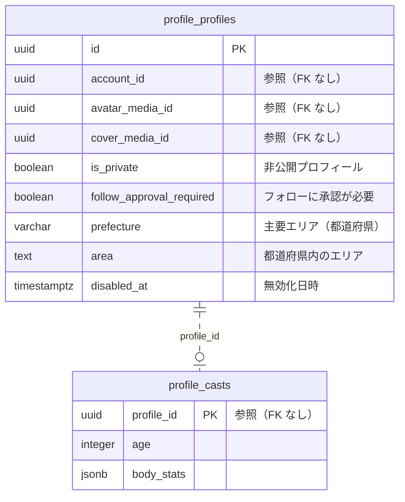

- `profile.profiles`: プロフィール本体。
  - 公開範囲（`is_private`）とフォロー承認の要否を持つ。
- `profile.casts`: キャストのプロフィールだけが持つ補足情報（年齢、体型など）。

[プロフィール](features/profiles.md)

## Post

投稿とその添付、メンション、いいね、コメント。

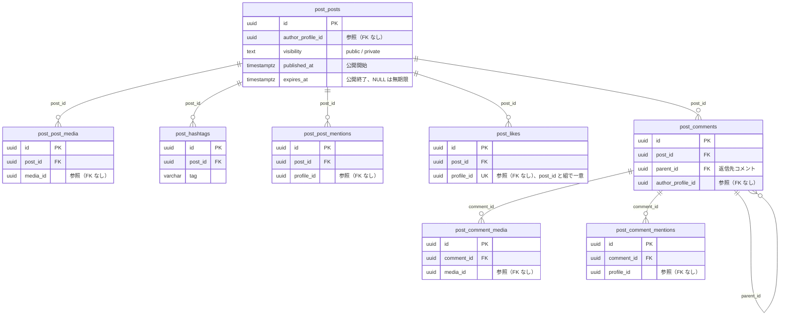

- `post.posts`: 投稿本体。
  - 公開範囲（`visibility`）と表示期間（`published_at` から `expires_at` まで）を持つ。
- `post.post_media`: 投稿に添付したメディア。
  - メディアを削除しても、そのメディアを指す添付の行は消えない。
    - 行は残り、配信 URL は空になる。
- `post.hashtags`: 投稿のハッシュタグ。
- `post.post_mentions`: 投稿本文中のメンション（対象プロフィール）。
- `post.likes`: 投稿へのいいね。
- `post.comments`: コメント。
  - `parent_id` で返信を表す。
  - 親コメントを削除すると、他のプロフィールの返信も削除される。
    - 返信の添付とメンションも同時に削除される。
  - 投稿のコメント数は、返信（`parent_id` のあるコメント）を含まない。
- `post.comment_media`: コメントに添付したメディア。
- `post.comment_mentions`: コメント本文中のメンション。

[投稿](features/posts.md)

## Social

フォローとブロック。
どちらもプロフィール同士の関係。

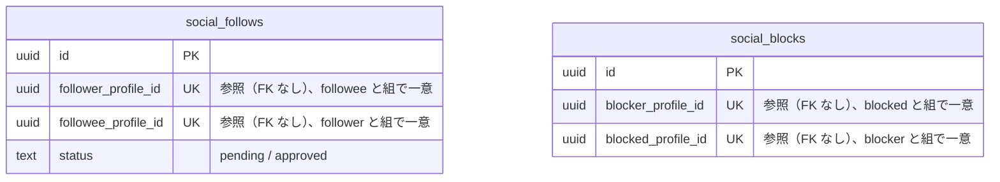

- `social.follows`: フォロー関係。
  - `status` が `pending` の間は承認待ち、`approved` で成立する。
- `social.blocks`: ブロック関係。

[フォロー・ブロック](features/follows-and-blocks.md)

## Schedule

キャストの予定（日付と時間帯）。
投稿と 1 対 1 で結べる。

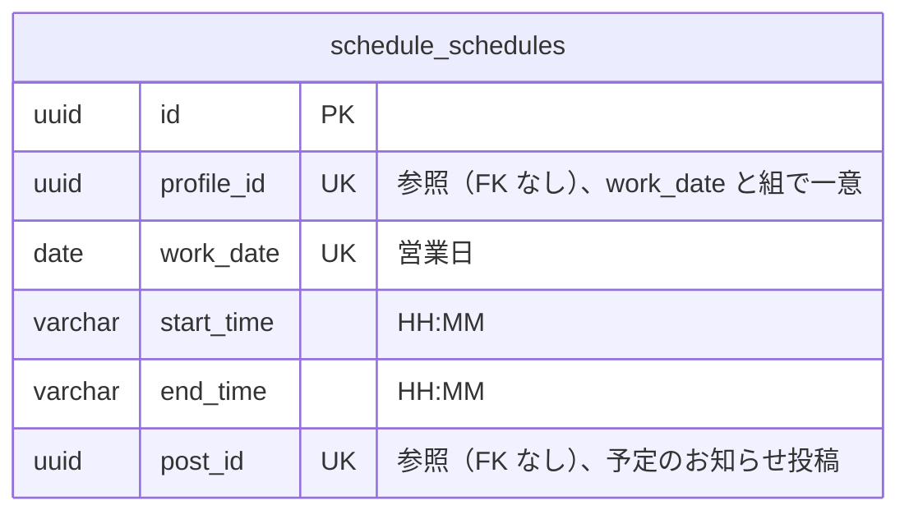

- `schedule.schedules`: 予定。
  - プロフィールと営業日ごとに 1 件。
  - `post_id` が入ると、その投稿を予定のお知らせとして扱う。

[予定](features/schedules.md)

## Feed

slice 内にテーブル定義（relation）を持たない。

[フィード・ランキング](features/feed-and-ranking.md)

## Discovery

slice 内にテーブル定義（relation）を持たない。

[検索](features/search.md)

## Bookmarks

ブックマーク。

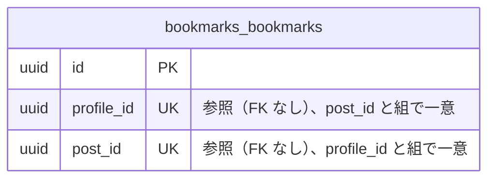

- `bookmarks.bookmarks`: プロフィールがブックマークした投稿。

[ブックマーク](features/bookmarks.md)

## Footprints

足あと（訪問の記録）と、足あとの既読状態。

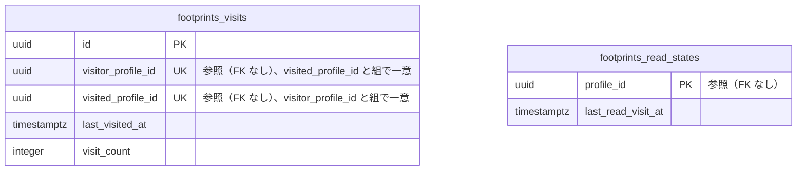

- `footprints.visits`: 訪問者と訪問先の組ごとに 1 件。
  - 最終訪問日時と訪問回数を持つ。
- `footprints.read_states`: プロフィールごとの足あとの既読位置。

[足あと](features/footprints.md)

## Messaging

メッセージのスレッド、メッセージ、既読位置。

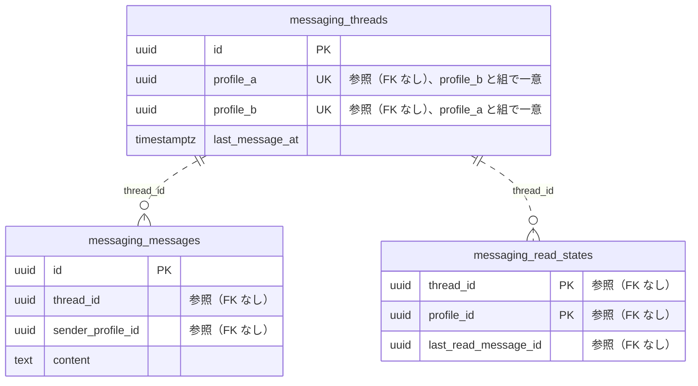

- `messaging.threads`: 2 プロフィール間のスレッド。
  - 組ごとに 1 件。
- `messaging.messages`: スレッド内のメッセージ。
- `messaging.read_states`: スレッドごと、プロフィールごとの既読位置。

[メッセージ](features/messages.md)

## Notifications

通知、通知の設定、プッシュ通知の購読先。

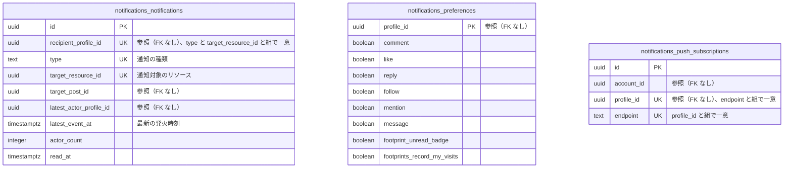

- `notifications.notifications`: 受信者ごとの通知。
  - 同じ種類・対象の通知は 1 件にまとめられ、`actor_count` で件数を持つ。
    - 同じプロフィールによる繰り返しの発火も件数に含まれる。
- `notifications.preferences`: プロフィールごとの通知の設定と足あとの設定。
  - 種類別の設定はプッシュ通知の送信だけを制御する。
- `notifications.push_subscriptions`: プロフィールごと・ブラウザごとのプッシュ通知の購読先。
  - endpoint とプロフィールの組で 1 件。
  - `account_id` は、別のアカウントが同じ端末を使い始めたときと、アカウントの削除処理で購読を消すのに使う。

[通知](features/notifications.md)

## Media

アップロードされたメディアファイル。

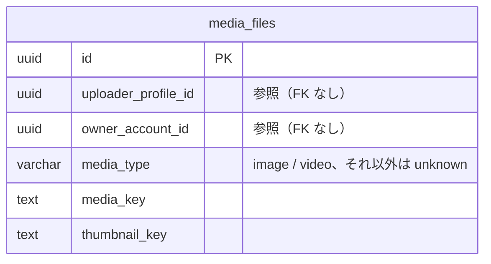

- `media.files`: メディアファイル。
  - アップロードしたプロフィールとアカウントを持つ。

[メディア](features/media.md)

## Karte

カルテ。
対象プロフィールに対する記録を持つ。

- `karte.kartes`: カルテ 1 件。
  - 作成者（アカウントとプロフィール）と対象プロフィールを持つ。
  - 評価は `rating` に入る。
- `karte.events`: カルテに記録した出来事（段階と結果）。

[カルテ](features/karte.md)

## Review

クチコミ。
カルテと同じ構造で、評価は 1〜5 の整数。

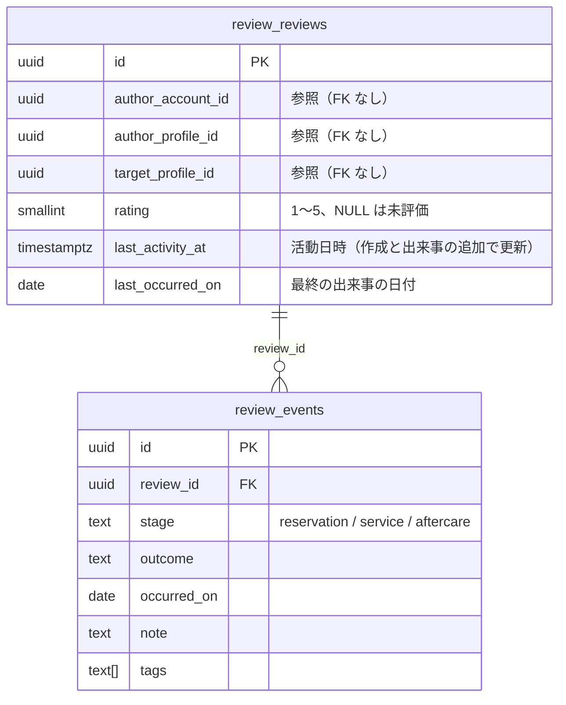

- `review.reviews`: クチコミ 1 件。
  - 作成者（アカウントとプロフィール）と対象プロフィールを持つ。
- `review.events`: クチコミに記録した出来事（段階と結果）。

[クチコミ](features/reviews.md)

## Billing

課金。
アカウント単位で Stripe の顧客と契約を持つ。
課金の行は、アカウントの削除処理の対象にならず、削除後も残る。

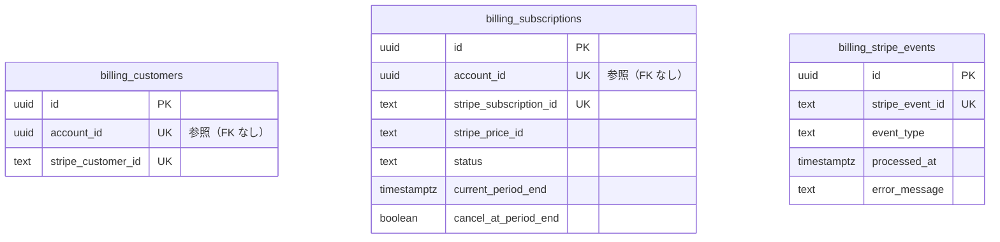

- `billing.customers`: アカウントと Stripe 顧客の対応。
  - アカウントごとに 1 件。
- `billing.subscriptions`: アカウントの契約。
  - アカウントごとに 1 件。
  - 現在の期間の終了日時と期間末での解約予定を持つ。
- `billing.stripe_events`: 受信した Stripe のイベント。
  - 処理日時とエラーを持つ。
  - 受信したイベントの全体を `payload` に保存する。

[課金](features/billing.md)
