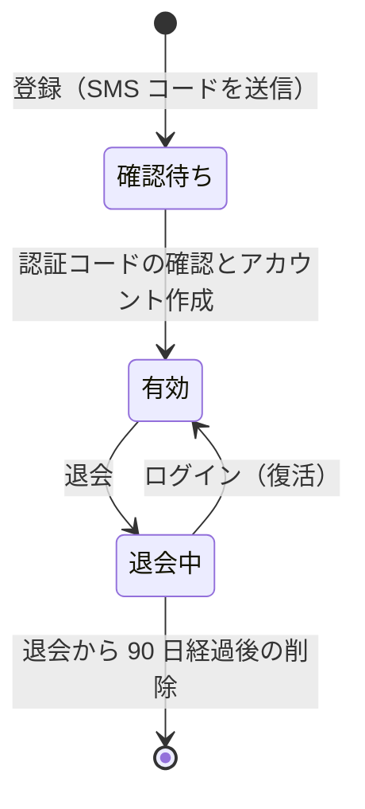

# アカウント

電話番号とパスワードで登録・ログインする、利用者の認証単位。
キャストとゲストの両方が使う。
登録時に選んだロール（キャストまたはゲスト）はアカウントに紐づき、登録後に変える手段はない。
アカウントは作成直後にはプロフィールを持たず、初回のプロフィール作成の後は 1 つ以上のプロフィールを持つ（[プロフィール](profiles.md)）。

## Rules

### 登録

| 条件 | 結果 |
|---|---|
| 電話番号が登録済み | 409。 「この電話番号は既に登録されています」 |
| パスワードが 12 文字未満、または大文字・小文字・数字・記号のいずれかを欠く | 登録できない |
| 認証コードが一致しない、または期限切れ | 400。 「認証コードが正しくありません」 |
| 認証コードを確認した後、アカウントの作成に失敗 | 電話番号は確認済みになるが、アカウントは作られない。 以後そのアカウントでログインすると 404 になる |

- 認証コードは SMS で送られる。
- 登録画面は年齢確認モーダルの確認と、規約・プライバシーポリシーへの同意チェックを必須にする。
  - この 2 つはサーバーに送られず、記録されない。
- ロールは登録画面のロール選択で決まる。
  - URL に `role=cast` があればキャストが初期選択になり、それ以外はゲストが初期選択になる。
- サーバーは登録時に送られたロールを保存し、ロールを確認する処理はない。
  - ロールが未指定または不明な値の場合は、ゲストとして保存する。

### ログイン

| 条件 | 結果 |
|---|---|
| 電話番号とパスワードが一致し、アカウントがある | ログインする。 退会中のアカウントなら復活する |
| 電話番号が未登録、またはパスワードが不一致 | 401。 「電話番号または認証コードが正しくありません」（両者で同じ応答） |
| 認証は通るがアカウントがない | 404。 「データが見つかりませんでした」を返す。 認証で発行されたトークンは無効化されず、cookie も設定されない。 |

- 認証基盤への問い合わせが失敗した場合も、同じ応答（401）を返す。
- 復活したときは「お帰りなさい。アカウントは復活しました。」を表示する。

### パスワード再設定

- 電話番号に SMS でコードを送る。
  - 未登録の電話番号にも同じ応答を返し、登録の有無は分からない。
- 再設定するパスワードは登録時と同じ方針に従う。
- コードの不一致・期限切れは「認証コードが正しくありません」。

### ログイン維持

- アクセストークンの有効期間は 1 時間、リフレッシュトークンの有効期間は 30 日（Cognito の設定）。
- ブラウザに保存される cookie は、アクセストークンが 1 時間、リフレッシュトークンが 30 日。
- アクセストークンの更新は `/api/` 宛ての要求を受けたときだけ行う。
  - 残りの有効期間が 60 秒以下なら、リフレッシュトークンでアクセストークンを取得し直す。
  - ページ遷移だけでは更新されない。
  - `/api/identity/` 配下の要求（`/api/identity/me` を除く）では更新しない。
    - 認証の route は自分で cookie を設定するため、更新と競合させない。
- 更新のたびに cookie の有効期限は 30 日後へ延びるが、Cognito のリフレッシュトークンは発行から 30 日で失効し、延びない。
  - そのため最後に認証してから 30 日を過ぎると、次の要求で 401 になる。
    - 401 に伴ってログイン情報を消すのは、`/api/identity/me` が 401 を返したときだけである。
- 更新に失敗したときは要求をそのまま通し、API が 401 を返す。

### ロックアウト

- アプリケーションはログインの失敗回数を数えず、アカウントをロックしない。
- Cognito の advanced security は OFF。

### 退会

| 条件 | 結果 |
|---|---|
| 設定画面で退会を実行 | アカウントに退会日時を記録する。 Cognito のグローバルサインアウトが成功すると、他の端末のリフレッシュトークンが無効になり、アクセストークンを取得し直せなくなる。 他の端末では、既に発行されたアクセストークンが、有効期限（最長 1 時間）まで有効なまま残る。 cookie は消える |
| 退会中（削除処理前） | 所有する全プロフィールが他人から見えなくなる（[プロフィール](profiles.md)）。 同じ電話番号でログインすると復活する（削除処理が済むまで） |
| 退会から 90 日を過ぎた | 次回の削除処理（下記）でアカウントとプロフィールが消える。 削除が済むまでの間に同じ電話番号でログインすると復活する。 カルテ、クチコミ、DM は残る（[カルテ](karte.md)、[クチコミ](reviews.md)）。 |

- Cognito のグローバルサインアウトが失敗しても、退会の記録と cookie の削除は行われる。
  - その場合、他の端末のリフレッシュトークンは有効なまま残る。
- 削除処理は毎日 04:00（日本時間）に実行する。
  - 失敗しても再試行せず、翌日の実行でやり直す。
- 削除処理は退会日時が「実行時刻の 90 日前より前」のアカウントを対象にする。
  - ちょうど 90 日の時点は対象外。
- 削除処理は 1 アカウントごとに次の順で消す。
  1. 所有するすべてのプロフィール（その中の投稿・コメント・いいね・メディアの行とファイルなど。消える範囲は [プロフィール](profiles.md) を参照）
  2. 通知の Web Push 購読
  3. Cognito のユーザー
  4. アカウント
- どれかが失敗したアカウントは退会中のまま残り、次回の実行で最初からやり直す。
  - 他のアカウントの処理は続ける。
- 運営者は、退会日時を 90 日より前の日時にしてから削除処理を実行すると、猶予を待たずにそのアカウントを消せる。
  - 18 歳未満、または高校生と分かった利用者の削除（規約第3条第3項）はこの方法で行う。
  - 手順は [dystopia/lambda](../../lambda/README.md) にある。

## Lifecycle

- 確認待ち: 電話番号とパスワードは登録済みだが、アカウントはまだない。
  - コードを確認しない限りログインできない。
- 有効: ログインでき、プロフィールを使える。
- 退会中: 他人から見えるプロフィールはなく、プロフィールを使う操作もできない。
  - Cognito のグローバルサインアウトが成功した場合は、退会前に発行されたアクセストークンの有効期限（最長 1 時間）までは、プロフィールの作成・有効化・無効化・削除ができる。
  - ログインすると有効に戻る。

## Interactions

- 退会中のアカウントのプロフィールは、検索・投稿・一覧のどこにも表示されない（[プロフィール](profiles.md)、[検索](search.md)、[投稿](posts.md)）。
- 他の利用者の投稿のいいね数とコメント数、および他の利用者のプロフィールのフォロー中・フォロワー数には、削除処理が済むまで、退会したアカウントの分が含まれる（[投稿](posts.md)、[フォロー・ブロック](follows-and-blocks.md)）。
- 削除処理で通知の Web Push 購読が消える（[通知](notifications.md)）。
- カルテとクチコミは削除処理の対象に含まれず、残る（[カルテ](karte.md)、[クチコミ](reviews.md)）。
- 退会したアカウントが送ったメッセージは、本文とスレッドが残り、送り主は表示されない（[メッセージ](messages.md)）。

## Data

- `identity.accounts`: アカウントと、登録時に決めたロール、退会日時。
- `notifications.push_subscriptions`: プロフィール × 端末の Web Push 購読。
  - アカウントの ID も持ち、削除処理で消える。
- Cognito のユーザープール: 電話番号とパスワードの認証情報。
  - 削除処理で消える。
  - 確認待ちのまま残った登録の認証情報は、削除処理の対象ではない。

## Rationale

- 退会は即時の削除ではなく 90 日の猶予を置く。
  - 猶予中はログインだけで復活できる。
  - 退会から短い期間でプロフィールが消えるとサービスの信頼性が下がり、積み上げたカルテも無駄になるため、猶予を長めに取る。
- 削除処理は失敗したアカウントを退会中のまま残す。
  - 途中で止まったアカウントが他人から見えない状態を保ち、次回の実行で消し直せるようにするため。
