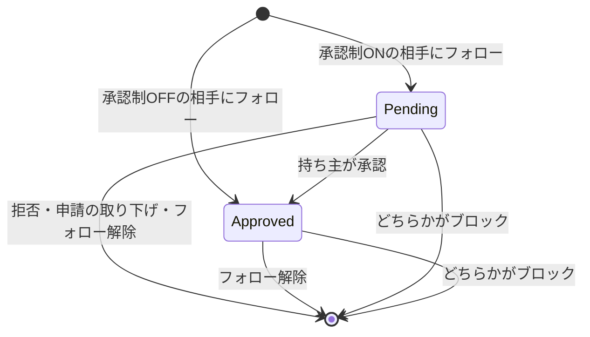

# フォロー・ブロック

プロフィール同士の関係を扱う機能。
フォローは承認済みと承認待ちの2状態を持ち、承認制のプロフィールへのフォローは申請になる。
ブロックは双方向に投稿の閲覧とフォローを遮断する。
キャストとゲストの両方が使う。

## Rules

### フォロー

フォローの結果は、相手プロフィールの承認制の設定と、両者のブロック関係で決まる。

| 状況 | 結果 |
| --- | --- |
| 相手が承認制OFF | 承認済み（即時）。 相手が鍵付きでも同じ |
| 相手が承認制ON | 承認待ち（申請） |
| ブロック関係がある（どちら向きでも） | フォローは成立しない。 記録は作られない |
| 相手が存在しない・無効・削除済み・アカウント退会中 | フォローは成立しない。 記録は作られない |
| 既に承認済みまたは承認待ちの関係がある | 変化なし。 既存の状態を返す |

- 承認制（フォローに承認が要るか）と鍵（投稿の閲覧を承認済みフォロワーに限るか）は別の設定。
  - 鍵はフォローの成否に影響せず、投稿の閲覧に影響する。
  - 詳細は [投稿](posts.md) を参照。
- 画面の表示は、承認制ONの相手には「フォローを申請」、申請中は「申請中」（押すと取り下げ）、承認済みは「フォロー中」。

### 申請と承認

| 操作 | 行う人 | 結果 | 通知 |
| --- | --- | --- | --- |
| 承認 | 持ち主 | 承認待ちを承認済みにする | 申請者には送らない |
| すべて承認 | 持ち主 | 承認待ちのうち表示できるプロフィールだけを承認する | 申請者には送らない |
| 拒否 | 持ち主 | 申請の記録を削除する。 申請者は再度申請できる | なし |
| 申請の取り下げ | 申請者 | 申請の記録を削除する | なし |
| フォロー解除 | フォロワー | 承認済みでも申請中でも記録を削除する | なし |

- フォローされたとき、承認制OFFの相手には「フォローされた」通知、承認制ONの相手には「フォロー申請」の通知が送られる。
- 持ち主の申請一覧には、承認待ちの記録がすべて出る。
  - 申請者が無効・削除済みの場合は一覧に出ず、すべて承認の対象にもならない。
- 承認制をOFFにしても、保留中の申請は承認待ちのまま残る。
  - 自動で承認されず、通知も送られない。
  - 持ち主が承認または拒否する。
- 承認制をONにしても、既存の承認済みフォロワーは変わらない。

### ブロック

ブロックは、ブロックした側が操作し、ブロックされた側には通知されない。

| 項目 | ブロックで起きること |
| --- | --- |
| フォロー関係 | 双方向の記録をすべて削除する（承認待ちを含む） |
| 新規フォロー | 双方向で成立しない |
| 投稿の閲覧 | 双方向で互いの投稿が見えない |
| メンションの通知 | 閲覧できない投稿のメンションは通知されない（双方向） |
| 通知 | ブロックした側は、ブロックした相手からの通知を受け取らない |
| コメント一覧 | ブロックした側の画面で、相手のコメントを除外する |

- ブロックの解除では、ブロック中に削除されたフォロー関係は戻らない。
- 解除の操作はブロック中の一覧から行う。

### プロフィールの無効化と削除

| 状態 | フォロー・ブロックの記録 | 投稿・申請 |
| --- | --- | --- |
| 無効 | 残る。 再有効化で元の関係に戻る | 投稿は本人以外から見えない。 フォロー・申請は成立しない・表示されない |
| 削除済み | 双方向の記録を削除する | 投稿・いいね・コメント・メンションも削除する |

- 無効化できるのは有効なプロフィールが2つ以上ある場合だけ。
  - 最後の有効なプロフィールは無効化できない。
- 削除は無効化されたプロフィールだけが対象。
  - 有効なプロフィールは先に無効化しなければ削除できない。
- アカウントが退会中の場合、そのアカウントのプロフィールは無効と同じ扱いになる。
  - アカウントの扱いは [アカウント](account.md) を参照。

### 関係の状態

## Lifecycle

- 承認待ち（Pending）: 申請者は申請中と表示される。
  - 持ち主の申請一覧に出る。
  - 鍵付きの投稿は見えない。
- 承認済み（Approved）: 申請者はフォロー中と表示される。
  - 鍵付きの投稿が見える。
- 関係なし: フォローできる状態。
  - ブロック関係があるとフォローは成立しない。
- ブロック: ブロックした側が解除するまで続く。
  - ブロック中はフォロー関係が残らない。
- 無効化・削除: [プロフィールの無効化と削除](#プロフィールの無効化と削除) の表のとおり。

## Interactions

- 投稿: 閲覧判定がフォロー関係と鍵を読む。
  - 詳細は [投稿](posts.md) を参照。
- 通知: フォロー・フォロー申請の通知を送る。
  - ブロックした側への通知は止まる。
  - 詳細は [通知](notifications.md) を参照。
- フィード・ランキング: フォロー中のタブは承認済みのフォロー関係だけを対象にする。
  - 詳細は [フィード・ランキング](feed-and-ranking.md) を参照。
- プロフィール: フォロー数・フォロワー数は承認済みの記録を数える。
  - 無効化された相手との関係も数に含まれる。
  - 詳細は [プロフィール](profiles.md) を参照。

## Data

- social.follows: フォロー関係と承認状態（承認済み・承認待ち）
- social.blocks: ブロック関係（ブロックした側と、された側）
- profile.profiles: 承認制と鍵の設定、無効化されているかどうか
- identity.accounts: アカウントが退会中かどうか

カラムの詳細は [data model](../data-model.md) を参照。

## Rationale

- 承認制と鍵を別の設定にしている。
  - 承認制はフォローの成否だけに効き、鍵は投稿の閲覧だけに効く。
  - 鍵付きでも承認制がOFFならフォローは即時に成立する。
- 解除後にフォローを戻す処理がない。
  - ブロックは両方向の記録を消すため。
  - 解除しても関係は戻らない。
