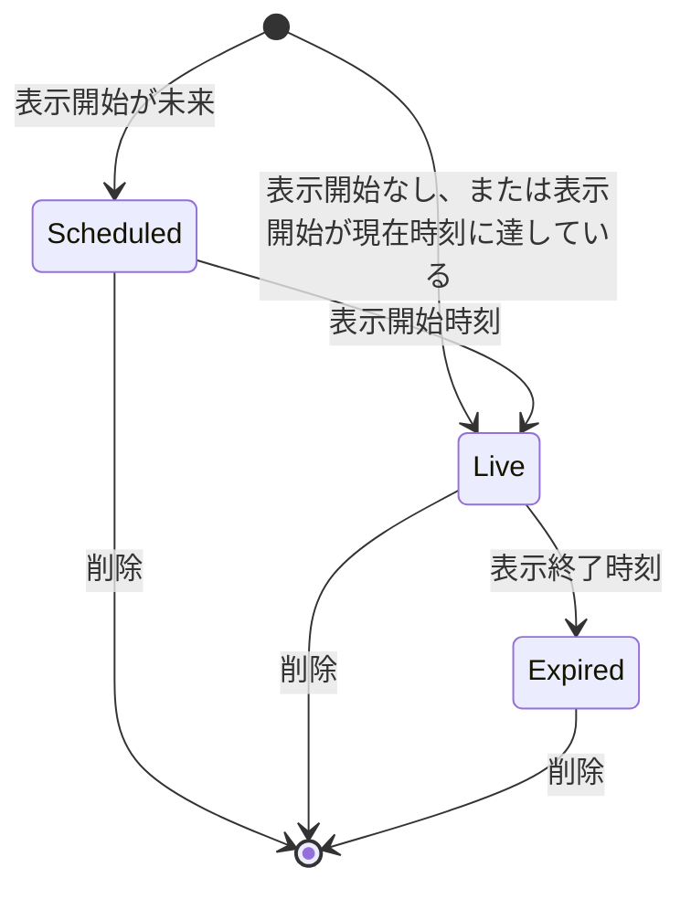

# 投稿

キャストとゲストが、プロフィールの名義で本文と画像・動画を投稿する機能。
投稿は公開範囲（全員 / フォロワーのみ）と表示期間を持ち、閲覧・いいね・コメント・メンション・引用は、いいねの取り消しを除き、投稿の閲覧可否の判定に従う。
両方のロールが使う。

## Rules

### 閲覧できる範囲

閲覧可否は投稿の公開範囲で決まる。
投稿者プロフィールの鍵は、閲覧可否に関係しない。

| 閲覧者 | 全員 | フォロワーのみ |
| --- | --- | --- |
| 未ログイン | × | × |
| 本人（投稿者のプロフィール） | ○ | ○ |
| 承認済みフォロワー | ○ | ○ |
| 承認待ち（申請中） | ○ | × |
| 非フォロワー | ○ | × |
| ブロック関係（どちら向きでも） | × | × |

- 閲覧の判定はプロフィール単位。
  - 同じアカウントの別プロフィールは、フォロー関係がなければ非フォロワーと同じ扱いになる。
- 投稿者プロフィールが無効化されているか削除済み、またはアカウントが退会中の場合、本人を除く全員から投稿は見えない。

### 投稿の作成

- 公開範囲の指定がなければ、サーバーは全員として保存する。
  - 全員（`public`）とフォロワーのみ（`private`）以外の値は拒否する（400）。
- 投稿画面の公開範囲の初期値は、鍵のないプロフィールでは全員、鍵付きのプロフィールでは「フォロワーのみ」。
  - プロフィールの読み込みが投稿画面の表示より遅れても、利用者がスイッチを触るまではプロフィールの鍵に合わせて変わる。
- 本文は空白のみでは保存できない。
  - 全角スペースなど Unicode の空白だけの本文も保存できない。
- 本文は1000文字以内。
  - 投稿画面とサーバーの両方が検査する。
- 画像と動画は合わせて4件まで。
  - 投稿画面が検査し、サーバーは件数を検査しない。
- 添付できるのは、使っているプロフィールがアップロードした画像と動画だけ。
- 本文の「#」または「＃」に続く、文字・数字・「_」だけからなる語がハッシュタグになる。
  - 「#」「＃」の直前が文字・数字・「_」・「#」・「＃」・「&」の場合は、ハッシュタグにならない。
  - 語が50文字を超える場合は、切り詰めず、ハッシュタグにならない。
  - 数字だけの語は、ハッシュタグにならない。
  - 同じタグは、大文字と小文字を区別せず1つにまとめ、先に書いた綴りを残す。
  - 投稿画面が本文から抽出したタグを送り、サーバーは送られたタグを本文と照合せずに保存する。
- 表示開始は未指定なら作成時刻になる。
  - 指定した場合は今より後の時刻のみ受け付ける。
- 表示終了は未指定なら無期限になる。
  - 指定した場合は表示開始より後かつ今より後の時刻のみ受け付ける。
- 画面で入力された日時は日本時間（+09:00）として扱う。
- 投稿は編集できない。
  - 本文・添付・公開範囲・表示期間は、作成の後に変えられない。
- 投稿の作成と削除は投稿者本人のプロフィールだけができる。

### 時間限定投稿（表示期間）

表示期間で、投稿の状態は予約中・表示中・表示終了の3つに分かれる。

| 状態 | 期間の条件 | 本人 | 本人以外 |
| --- | --- | --- | --- |
| 予約中 | 表示開始が現在時刻より後 | 見える（一覧と詳細） | 見えない |
| 表示中 | 表示開始が現在時刻に達しており、かつ表示終了がないか表示終了が現在時刻より後 | 公開範囲どおり | 公開範囲どおり |
| 表示終了 | 表示終了が現在時刻に達している | 見える（表示終了の印付き） | 見えない |

- 境界は、表示開始の時刻ちょうどから表示中、表示終了の時刻ちょうどから表示終了となる。
- 表示終了になっても投稿は削除されない。
  - 本人の一覧には残る。
- 検索・ハッシュタグ検索・いいね数ランキングは、表示中かつ全員の投稿だけを対象にする。

### 予定のお知らせ投稿

予定の保存でお知らせ投稿が作られると、通常の投稿と同じ投稿の行になり、公開範囲は全員、本文はお知らせの一言になる。
表示開始はお知らせの時刻（既に過ぎていれば保存時刻）、表示終了は予定の終了時刻になる。
お知らせ投稿は、予定の保存と予定の削除によって作成・更新・削除される。
投稿の削除でも、お知らせ投稿を削除できる。
投稿を削除しても、予定の行は残る。
次にお知らせを付けて予定を保存したとき、予定の終了時刻を過ぎていなければ、お知らせ投稿を作り直す。
詳細は [予定](schedules.md) を参照。

### ピン留め

プロフィールごとに1件の投稿を、プロフィールの「投稿」タブの先頭に固定できる。

- 自分の投稿のカードの「その他の操作」メニューから、確認なしで切り替わる。
  - 別の投稿をピン留めすると、前の投稿のピン留めは外れる。
- ピン留めできるのは投稿だけで、コメントと返信はできない。
- ピン留めした投稿は「投稿」タブの先頭に印付きで出て、その下の新しい順の一覧には重ねて出さない。
  - 1ページの件数には数えない。
- 「メディア」タブ・「いいね」タブ・フィード・検索・ランキングの並びは変わらない。
  - 「メディア」タブでは印も付けず、投稿の時刻の位置に出す。
- ピン留めしても投稿の時刻は変わらず、通知も送らない。
- 閲覧の範囲は変わらない。
  - 閲覧できない人には先頭にも出さず、ピン留めのない一覧と同じになる。
  - 予約中と表示終了の投稿も本人の先頭には出るが、本人以外には出ない。
- 投稿を削除するとピン留めも外れ、別の投稿は繰り上がらない。

### メンション

- 候補の出し方: 本文で、直前が英数字・「_」・「@」でない「@」を入力すると、「@」の後の文字列（0〜30文字）で候補が出る。
  - 候補は自分が承認済みでフォローしているプロフィールだけで、表示名かユーザー名に部分一致するものを最大5件表示する。
- 候補にないプロフィールも、ユーザー名（英数字と「_」の3〜30文字）を本文に書けば、メンションとして保存される。
  - フォロー関係は問わない。
  - 無効化されたプロフィールはメンションにならない。
  - 退会中のアカウントのプロフィールも、メンションにならない。
- 通知は投稿の作成時だけ送る。
  - 表示開始が未来の予約投稿は、作成時も表示開始後も通知を送らない。
- 通知は、メンションされたプロフィールがその投稿を閲覧できる場合だけ送る。
  - 閲覧できない場合は通知されない。
- 同じプロフィールを複数回メンションしても通知は1件。
- 自分自身へのメンションは通知しない。
- 投稿に付いたメンションは、投稿を閲覧できる人にだけ表示される。

### いいね

- 閲覧できる投稿だけにいいねできる。
  - 閲覧できない投稿は見つからない扱いになる。
- いいねの取り消しは閲覧可否を確認しない。
- いいね数は投稿を閲覧できる人に見える。
- 投稿者本人がいいねした場合は通知しない。
- いいね一覧は、本人だけが見られる。
  - 本人の一覧には、閲覧できる投稿だけを表示する。

### コメント

- 閲覧できる投稿にだけコメントできる。
- 本文は1000字以内。
- 画像と動画は合わせて3件まで。
- 添付できるのは、使っているプロフィールがアップロードした画像と動画だけ。
- 本文が空で添付もない場合は保存できない。
  - 全角スペースなど Unicode の空白だけの本文は、空として扱う。
- 返信は1段だけ。
  - 返信への返信はできない。
- 返信先のコメントは同じ投稿のものに限る。
- コメントの削除はコメントを書いたプロフィールだけができる。
  - 投稿者も他人のコメントは削除できない。
  - コメントを削除すると、そのコメントへの返信も消える。
    - 返信は、他の利用者が書いたものも消える。
  - コメントと返信に付いた画像・動画は、ほかで使われていなければ、ファイルも消える（[メディア](media.md)）。
- コメントと返信は、投稿を見られる人に名前付きで見える。
  - 書いた人の鍵は関係しない。
- プロフィールに、その人のコメントと返信の一覧はない。
- コメント一覧と返信一覧では、閲覧者がブロックしているプロフィールのコメントを除外する。
- 無効化・退会中・削除済みのプロフィールのコメントは、コメント一覧と返信一覧に出ない。
  - 親コメントの作者が無効化・退会中・削除済みの場合は、その親コメントの返信一覧も空になる。
  - 投稿のコメント数には含まれる。
- コメントと返信は、新しい順に表示する。
- 投稿のコメント数は、返信を含まない。
- 投稿のコメント数・いいね数は、閲覧者がブロックしているプロフィールの分を除く。
  - 閲覧者をブロックしているプロフィールの分は除かない。
  - ログインしていない閲覧者の数からは、誰の分も除かない。
  - 投稿の取得・一覧・フィード・検索・いいねの応答のどれでも同じ数になる。

### 引用

投稿に自分の本文を添えて、新しい投稿として作成できる。
引用された投稿を引用元と呼び、引用した投稿を引用投稿と呼ぶ。

引用元にできるのは、引用する人が今見られて、公開範囲が「全員」で、表示中の投稿だけ。
投稿者とのロールの組み合わせは問わない。

| 引用元 | 引用 |
| --- | --- |
| 「全員」公開で表示中の他人の投稿 | できる |
| 鍵付きプロフィールの「全員」公開の投稿 | できる |
| 自分の「全員」公開で表示中の投稿 | できる |
| 「全員」公開で表示中の引用投稿 | できる |
| 「全員」公開で表示中の予定のお知らせ投稿 | できる |
| 「フォロワーのみ」の投稿（自分の投稿も含む） | できない |
| ブロック関係（どちら向きでも）にある相手の投稿 | できない |
| 予約中または表示終了の投稿（自分の投稿も含む） | できない |
| コメントと返信 | できない |

- 鍵付きプロフィールの投稿を引用できる。
  - 鍵は投稿の閲覧に効かないため。
  - 鍵付きプロフィールの投稿画面の初期値は「フォロワーのみ」なので、「全員」は本人が選んだものと見なす。
- 引用できるかの判定はサーバーでも行う。
  - 引用元にできない投稿を指定した作成は、拒否する（400）。
  - 存在しない投稿や、ID が UUID の形でない指定も同じ。
- 引用元の本文と公開範囲は後から変わらない。
  - 投稿は編集できないため。
  - 例外はお知らせ投稿で、同じ行のまま予定の保存でひとことと終了時刻が更新される。
    - 引用枠には更新後の内容を出す。
    - 終了時刻が未来に延びれば、見えなくなっていた引用枠も再び見える。
  - お知らせ投稿が削除された後に作り直されると、新しい行になり、既存の引用は付け替えない。
    - 既存の引用の枠は「この投稿は表示できません」のままになる。
    - 新しいお知らせ投稿の引用数は 0 から始まる。

引用投稿は、引用元の投稿を指す情報を持つ通常の投稿。

- 本文は必須で、通常の投稿と同じ検証をする。
- 公開範囲・表示開始・表示終了・添付・ハッシュタグ・メンションは、通常の投稿と同じ。
  - 「フォロワーのみ」の引用も作れる。
    - 元の投稿者がフォロワーでなければ、その引用は見えず、通知も届かない。
- 引用元は、作成の後に変えられない。
- フィード・検索・ハッシュタグ・いいね・コメントの対象になるのも、通常の投稿と同じ。
- 検索とハッシュタグは、引用投稿自身の本文だけを対象にする。
  - 引用元の本文では当たらない。
- プロフィールの「メディア」タブは、引用投稿自身の添付だけを対象にする。

引用の作成画面は、通常の投稿の作成画面に引用元を足したもの。

- 引用元のカードの引用アイコンを押すと作成画面が開き、1 回押すだけで投稿されることはない。
  - 作成画面には引用元を枠で表示する。
  - 枠は押しても開かない。
- 投稿の詳細を開いたまま、詳細の中の投稿の引用アイコンを押すと、詳細を閉じてから作成画面を開く。
  - 先に開くと、詳細を閉じる操作で作成画面も閉じてしまうため。
- 引用を投稿すると作成画面が閉じ、元の投稿の引用数が、そのカードが並ぶどの一覧でもすぐ 1 増える。
  - フィードは読み込み直さないので、読んでいた位置は変わらない。
    - 深くまで読み進めた人が、先頭へ戻されないため。
  - 新しい引用投稿は、フィードの次の読み込みで現れる。

引用枠は、引用投稿のカードに引用元を示す。
中身は、見る人ごとに判定する。

- 見られるとき: 投稿者の名前（鍵マークとユーザー名を含む）、本文、画像・動画、投稿の時刻を小さく表示する。
  - 長い本文は 4 行で、画像・動画は 4 件で打ち切る。
  - お知らせ投稿では予定の表示も出す。
  - 押すと引用元の詳細を開く。
  - 引用元がさらに引用していても、枠の中に枠は出さない。
- 見られないとき: 枠に「この投稿は表示できません」と表示し、引用投稿の本文はそのまま残す。
  - 対象は、投稿の閲覧判定で見えなくなるすべて。
    - 削除・表示終了・ブロック関係・投稿者の無効化・投稿者の削除・アカウントの退会など。
  - 理由は出し分けない。

引用元のカードのリアクション列には、いいねの次に引用のアイコンと数字を出す。

- 並びは、いいね・引用のアイコンと数字・コメント・ブックマークの順。
- 自分の投稿では、投稿者名の行の右端に「その他の操作」メニューが出る。
  - ピン留めと削除は、このメニューの中にある。
- アイコンと数字は別々に押せる。
  - アイコンは引用の作成画面を開く。
  - 数字は投稿の詳細を引用タブで開く。
    - 詳細を開いている投稿の数字は、押しても何も起きない。
- 文字のラベルは付けない。
- 引用できない投稿では、アイコンを無効の見た目にし、数字は押せる。
  - 自分の予約中と表示終了の投稿でも同じ。
- リアクション列は同じ幅の列に並べ、ブックマークだけを行の右端に置く。
  - 自分の投稿でも他人の投稿でも、数字の桁が違っても、アイコンの位置が揃うため。

引用数は、閲覧者が引用タブで見られる件数と一致する。

- 閲覧者とブロック関係（どちら向きでも）にある人の引用は、数えない。
- 閲覧者が見られない「フォロワーのみ」の引用は、数えない。
- 予約中と表示終了の引用は、本人以外には数えない。
- 無効化・退会中・削除済みの投稿者の引用は、数えない。
- 引用が多い投稿でも、上限表示や概数にせず、正確な件数を出す。

投稿の詳細は、コメント欄をコメントと引用のタブに分ける。

- 既定はコメントのタブ。
  - 引用の数字を押したときと、引用の通知から開いたときは、引用タブで開く。
- タブの見出しに、それぞれの件数を出す。
- 引用タブには、閲覧者が見られる引用投稿を新しい順に並べる。
  - 並びとページングはフィードと同じで、公開開始時刻の降順、同じ時刻は ID の降順。
  - 1 ページは既定 20 件、上限 50 件。
  - 引用元を閲覧できない人は、一覧を取得できない（見つからない扱い）。
- 引用タブの各行は通常の投稿カードで、引用枠は出さない。
  - 引用元が同じ画面の上にあるため。

### 投稿の削除

- 投稿者本人のプロフィールだけが削除できる。
  - 自分の投稿のカードの「その他の操作」メニューから、確認のあとに削除する。
- 削除すると、投稿本体と、いいね・コメント・メンション・ハッシュタグが同時に消える。
- 引用元の投稿を削除しても、その投稿を引用した投稿は残る。
  - 引用投稿の枠は、「この投稿は表示できません」になる。
- 投稿を削除しても、その投稿への通知の行は残る。
- 投稿と、その投稿のコメント・返信に付いた画像・動画は、ほかで使われていなければ、ファイルも消える（[メディア](media.md)）。

## Lifecycle

- Scheduled（予約中）: 本人だけが見られる。
  - 本人の一覧では予約の日時付きで表示される。
- Live（表示中）: 公開範囲と閲覧者の関係に従って見える。
- Expired（表示終了）: 本人だけが見られる。
  - 自動で削除されることはない。
- 削除: 投稿者が削除すると、どの状態からでも消える。

## Interactions

- 通知: メンション・いいね・コメント・返信・引用の通知を発生させる。
  - 通知の種類と送り先は [通知](notifications.md) を参照。
- フィード・ランキング: フィードの絞り込み（全国・フォロー中・フォロワーなど）は別の規則で決まる。
  - 引用投稿は通常の投稿と同じに並び、引用数は順位に使わない。
  - 詳細は [フィード・ランキング](feed-and-ranking.md) を参照。
- 検索: 表示中かつ全員の投稿だけが検索結果に出る。
  - フォロワーのみの投稿は検索に出ない。
  - 詳細は [検索](search.md) を参照。
- 予定: 予定の保存がお知らせ投稿を作る・更新する・削除する。
  - 詳細は [予定](schedules.md) を参照。
- フォロー・ブロック: 閲覧判定がフォロー関係とブロック関係を読む。
  - 引用の可否・引用枠・引用数・引用の一覧も、同じ判定を通る。
  - 詳細は [フォロー・ブロック](follows-and-blocks.md) を参照。
- プロフィールの削除: 投稿者のプロフィールを削除すると、その投稿・いいね・コメント・メンションが消える。
  - 詳細は [プロフィール](profiles.md) を参照。

## Data

- post.posts: 投稿本体、公開範囲、表示開始と表示終了、ピン留めの日時、引用元の投稿
- post.post_media: 投稿に付く画像と動画
- post.hashtags: 投稿のハッシュタグ
- post.post_mentions: 投稿のメンション（プロフィールと本文中の位置）
- post.likes: いいね
- post.comments: コメントと返信
- post.comment_media: コメントに付く画像と動画
- post.comment_mentions: コメントのメンション（プロフィールと本文中の位置）
- social.follows: 閲覧判定に使うフォロー関係と承認状態
- social.blocks: 閲覧判定に使うブロック関係
- profile.profiles: 投稿者が無効化されているかどうか
- identity.accounts: 閲覧判定に使う退会の状態

カラムの詳細は [data model](../data-model.md) を参照。

## Rationale

- ピン留めは投稿の行に持たせる。
  - 投稿の削除で一緒に消えるので、外す処理を別に持たなくてよいため。
- 閲覧判定は social slice の1か所にまとめ、一覧・詳細・いいね・コメント・メンションが同じ判定を使う。
  - 判定を分けると、一覧に出るのに詳細は開けない投稿が生じる。
- 投稿は編集できないようにし、削除で取り消す。
  - コメントがついた後に内容を変えられると、話の前提が変わるため。
- コメントの見え方は元の投稿に従わせ、書いた人の鍵では絞らない。
  - 投稿者に見えないコメントができると、ブロックも運営者への申出もできないため。
  - 欄の途中のコメントを隠すと、話がつながらなくなるため。
- プロフィールごとのコメントの一覧は持たない。
  - 鍵付きの人の発言を、投稿をまたいで追えてしまうため。
- 表示期間の判定はアプリケーションの現在時刻で行い、データベースの現在時刻は使わない。
  - 判定が二か所で食い違うと、一覧と保存時の検証が別の結果になる。
- 本人だけが予約中と表示終了の投稿を見られる。
  - 予約中の投稿と表示が終わった投稿を、本人が確認し、削除できるようにするため。
- 引用元にできるのは、「全員」公開の投稿だけ。
  - 「フォロワーのみ」の投稿への意見だけが、中身を見られない人に届く状態を避けるため。
- 引用枠と引用一覧は、投稿の閲覧判定をそのまま通す。
  - 引用を経由して、見られないはずの投稿の中身が見えてしまうのを避けるため。
- 引用から自分の投稿を外す操作と、引用を禁止する設定は作らない。
  - 引用された人が取れる手段は、元の投稿の削除とブロックで足りると判断したため。
- 引用数は、閲覧者が引用タブで見られる件数に合わせる。
  - 数と一覧が食い違うと、数字を押しても同じ数の引用が並ばないため。
  - コメント数・いいね数の規則（閲覧者がブロックした側だけを除く）とは異なる。
- 引用数は、行を読み込まずにデータベースで集計する。
  - 閲覧判定は取得済みの行を絞る作りなので、全引用行を通すと引用数に比例して重くなるため。
