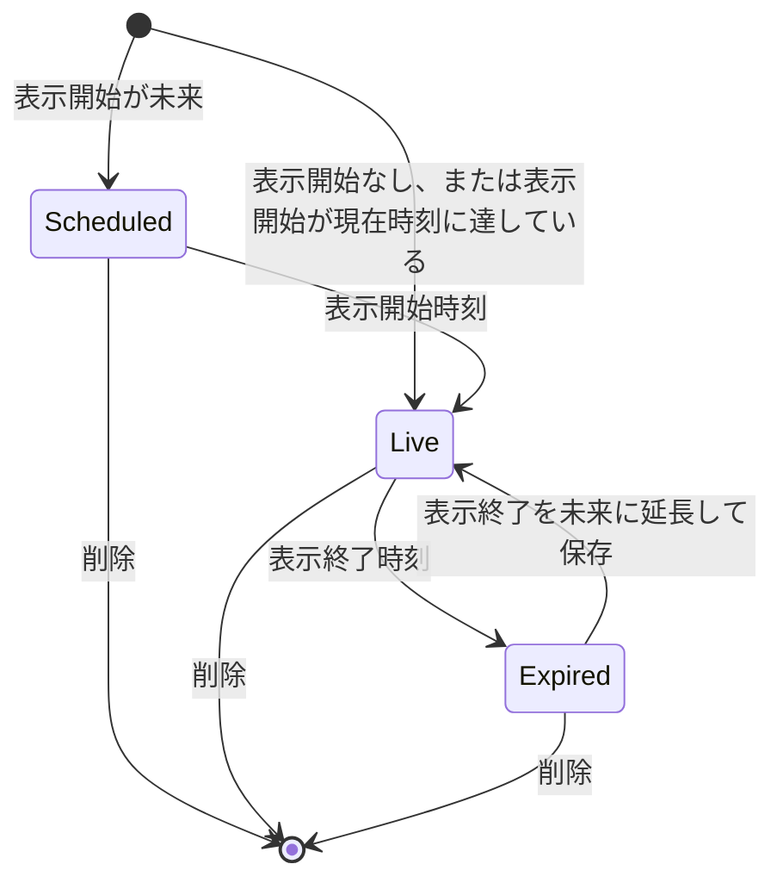

# 投稿

キャストとゲストが、プロフィールの名義で本文と画像・動画を投稿する機能。
投稿は公開範囲（全員 / フォロワーのみ）と表示期間を持ち、閲覧・いいね・コメント・メンションは、いいねの取り消しを除き、投稿の閲覧可否の判定に従う。
両方のロールが使う。

## Rules

### 閲覧できる範囲

閲覧可否は投稿の公開範囲と投稿者プロフィールの鍵の組み合わせで決まる。
投稿者プロフィールの鍵は、投稿の公開範囲が全員でもフォロワーのみでも、全員の投稿を承認済みフォロワーだけに絞る。

| 閲覧者 | 全員・公開プロフィール | 全員・鍵付きプロフィール | フォロワーのみ |
| --- | --- | --- | --- |
| 未ログイン | × | × | × |
| 本人（投稿者のプロフィール） | ○ | ○ | ○ |
| 承認済みフォロワー | ○ | ○ | ○ |
| 承認待ち（申請中） | ○ | × | × |
| 非フォロワー | ○ | × | × |
| ブロック関係（どちら向きでも） | × | × | × |

- 閲覧の判定はプロフィール単位。
  - 同じアカウントの別プロフィールは、フォロー関係がなければ非フォロワーと同じ扱いになる。
- 投稿者プロフィールが無効化されているか削除済み、またはアカウントが退会中の場合、本人を除く全員から投稿は見えない。
- 承認待ちは、投稿者プロフィールが公開の場合に限り、全員の投稿だけ見える。

### 投稿の作成と編集

- 公開範囲の指定がなければ、サーバーは全員として保存する。
- 投稿画面の公開範囲の初期値は、鍵のないプロフィールでは全員、鍵付きのプロフィールでは「フォロワーのみ」。
  - プロフィールの読み込みが投稿画面の表示より遅れても、利用者がスイッチを触るまではプロフィールの鍵に合わせて変わる。
- 本文は空白のみでは保存できない。
- 本文は1000文字以内。
  - 投稿画面が検査し、サーバーは文字数を検査しない。
- 画像と動画は合わせて4件まで。
  - 投稿画面が検査し、サーバーは件数を検査しない。
- 本文の「#」または「＃」に続く、文字・数字・「_」だけからなる語がハッシュタグになる。
  - 「#」「＃」の直前が文字・数字・「_」・「#」・「＃」・「&」の場合は、ハッシュタグにならない。
  - 語が50文字を超える場合は、切り詰めず、ハッシュタグにならない。
  - 数字だけの語は、ハッシュタグにならない。
  - 同じタグは、大文字と小文字を区別せず1つにまとめ、先に書いた綴りを残す。
  - 投稿画面が本文から抽出したタグを送り、サーバーは送られたタグを本文と照合せずに保存する。
- 表示開始は未指定なら作成時刻になる。
  - 指定した場合は今より後の時刻のみ受け付ける。
- 表示終了は未指定なら無期限になる。
  - 指定した場合は表示開始より後かつ今より後の時刻のみ受け付ける。
- 編集では、表示中の投稿の表示開始は元の時刻のまま固定される。
  - 表示開始を書き換えられるのは表示開始前（予約中）の投稿だけ。
- 編集で表示終了を元の時刻のまま保存する場合は、表示終了が過去でも保存できる。
- 画面で入力された日時は日本時間（+09:00）として扱う。
- 投稿の作成・編集・削除は投稿者本人のプロフィールだけができる。

### 時間限定投稿（表示期間）

表示期間で、投稿の状態は予約中・表示中・表示終了の3つに分かれる。

| 状態 | 期間の条件 | 本人 | 本人以外 |
| --- | --- | --- | --- |
| 予約中 | 表示開始が現在時刻より後 | 見える（一覧と詳細） | 見えない |
| 表示中 | 表示開始が現在時刻に達しており、かつ表示終了がないか表示終了が現在時刻より後 | 公開範囲どおり | 公開範囲どおり |
| 表示終了 | 表示終了が現在時刻に達している | 見える（表示終了の印付き） | 見えない |

- 境界は、表示開始の時刻ちょうどから表示中、表示終了の時刻ちょうどから表示終了となる。
- 表示終了になっても投稿は削除されない。
  - 本人の一覧には残る。
- 検索・ハッシュタグ検索・いいね数ランキングは、表示中かつ全員の投稿だけを対象にする。

### 予定のお知らせ投稿

予定の保存でお知らせ投稿が作られると、通常の投稿と同じ投稿の行になり、公開範囲は全員、本文はお知らせの一言になる。
表示開始はお知らせの時刻（既に過ぎていれば保存時刻）、表示終了は予定の終了時刻になる。
お知らせ投稿は、予定の保存と予定の削除によって作成・更新・削除される。
投稿の編集と削除でも、お知らせ投稿を変更・削除できる。
投稿を削除しても、予定の行は残る。
次にお知らせを付けて予定を保存したとき、予定の終了時刻を過ぎていなければ、お知らせ投稿を作り直す。
詳細は [予定](schedules.md) を参照。

### メンション

- 候補の出し方: 本文で、直前が英数字・「_」・「@」でない「@」を入力すると、「@」の後の文字列（0〜30文字）で候補が出る。
  - 候補は自分が承認済みでフォローしているプロフィールだけで、表示名かユーザー名に部分一致するものを最大5件表示する。
- 候補にないプロフィールも、ユーザー名（英数字と「_」の3〜30文字）を本文に書けば、メンションとして保存される。
  - フォロー関係は問わない。
  - 無効化されたプロフィールはメンションにならない。
  - 退会中のアカウントのプロフィールも、メンションにならない。
- 通知は投稿の作成時だけ送る。
  - 編集では送らない。
  - 表示開始が未来の予約投稿は、作成時も表示開始後も通知を送らない。
- 通知は、メンションされたプロフィールがその投稿を閲覧できる場合だけ送る。
  - 閲覧できない場合は通知されない。
- 同じプロフィールを複数回メンションしても通知は1件。
- 自分自身へのメンションは通知しない。
- 投稿に付いたメンションは、投稿を閲覧できる人にだけ表示される。

### いいね

- 閲覧できる投稿だけにいいねできる。
  - 閲覧できない投稿は見つからない扱いになる。
- いいねの取り消しは閲覧可否を確認しない。
- いいね数は投稿を閲覧できる人に見える。
- 投稿者本人がいいねした場合は通知しない。
- いいね一覧は、本人だけが見られる。
  - 本人の一覧には、閲覧できる投稿だけを表示する。

### コメント

- 閲覧できる投稿にだけコメントできる。
- 本文は1000字以内。
- 画像と動画は合わせて3件まで。
- 本文が空で添付もない場合は保存できない。
- 返信は1段だけ。
  - 返信への返信はできない。
- 返信先のコメントは同じ投稿のものに限る。
- コメントの削除はコメントを書いたプロフィールだけができる。
  - 投稿者も他人のコメントは削除できない。
  - コメントを削除すると、そのコメントへの返信も消える。
    - 返信は、他の利用者が書いたものも消える。
  - コメントに付いた画像・動画は、コメントを削除しても、ファイルは残る。
    - ファイルを消すのは、利用者によるメディアの削除と、プロフィールの削除（アカウントの削除を含む）だけ（[メディア](media.md)）。
- コメント一覧では、閲覧者がブロックしているプロフィールのコメントを除外する。
- 無効化・退会中・削除済みのプロフィールのコメントは、コメント一覧と返信一覧に出ない。
  - 親コメントの作者が無効化・退会中・削除済みの場合は、その親コメントの返信一覧も空になる。
  - 投稿のコメント数には含まれる。
- コメントと返信は、新しい順に表示する。
- 投稿のコメント数は、返信を含まない。

### 投稿の削除

- 投稿者本人のプロフィールだけが削除できる。
- 削除すると、投稿本体と、いいね・コメント・メンション・ハッシュタグが同時に消える。
- 投稿を削除しても、その投稿への通知の行は残る。
- 投稿に付いた画像・動画は、投稿を削除しても、ファイルは残る。
  - 削除後も、ログイン済みの利用者はメディア ID を知っていれば配信 URL を取得できる（[メディア](media.md)）。

## Lifecycle

- Scheduled（予約中）: 本人だけが見られる。
  - 本人の一覧では予約の日時付きで表示される。
- Live（表示中）: 公開範囲と閲覧者の関係に従って見える。
- Expired（表示終了）: 本人だけが見られる。
  - 自動で削除されることはない。
- 削除: 投稿者が削除すると、どの状態からでも消える。

## Interactions

- 通知: メンション・いいね・コメント・返信の通知を発生させる。
  - 通知の種類と送り先は [通知](notifications.md) を参照。
- フィード・ランキング: フィードの絞り込み（全国・フォロー中・フォロワーなど）は別の規則で決まる。
  - 詳細は [フィード・ランキング](feed-and-ranking.md) を参照。
- 検索: 表示中かつ全員の投稿だけが検索結果に出る。
  - フォロワーのみの投稿は検索に出ない。
  - 詳細は [検索](search.md) を参照。
- 予定: 予定の保存がお知らせ投稿を作る・更新する・削除する。
  - 詳細は [予定](schedules.md) を参照。
- フォロー・ブロック: 閲覧判定がフォロー関係とブロック関係を読む。
  - 詳細は [フォロー・ブロック](follows-and-blocks.md) を参照。
- プロフィールの削除: 投稿者のプロフィールを削除すると、その投稿・いいね・コメント・メンションが消える。
  - 詳細は [プロフィール](profiles.md) を参照。

## Data

- post.posts: 投稿本体、公開範囲、表示開始と表示終了
- post.post_media: 投稿に付く画像と動画
- post.hashtags: 投稿のハッシュタグ
- post.post_mentions: 投稿のメンション（プロフィールと本文中の位置）
- post.likes: いいね
- post.comments: コメントと返信
- post.comment_media: コメントに付く画像と動画
- post.comment_mentions: コメントのメンション（プロフィールと本文中の位置）
- social.follows: 閲覧判定に使うフォロー関係と承認状態
- social.blocks: 閲覧判定に使うブロック関係
- profile.profiles: 投稿者の鍵と、無効化されているかどうか
- identity.accounts: 閲覧判定に使う退会の状態

カラムの詳細は [data model](../data-model.md) を参照。

## Rationale

- 閲覧判定は social slice の1か所にまとめ、一覧・詳細・いいね・コメント・メンションが同じ判定を使う。
  - 判定を分けると、一覧に出るのに詳細は開けない投稿が生じる。
- 表示期間の判定はアプリケーションの現在時刻で行い、データベースの現在時刻は使わない。
  - 判定が二か所で食い違うと、一覧と保存時の検証が別の結果になる。
- 本人だけが予約中と表示終了の投稿を見られる。
  - 予約中の投稿の確認と、表示終了後の延長編集を本人ができるようにするため。
