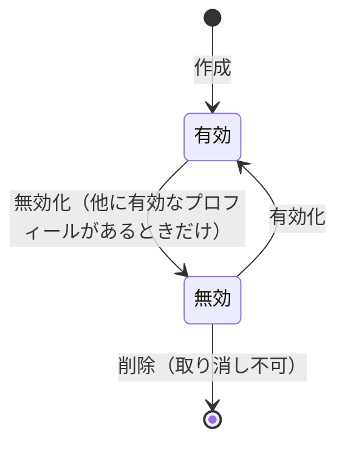

# プロフィール

1 つのアカウントが持つ、人格ごとの表示単位。
表示名・ユーザー名・自己紹介・アバターなどを持ち、投稿・フォロー・クチコミの作成などの行為はプロフィール単位で行う。
キャストとゲストの両方が使う。
ロールはアカウントの属性で、アカウントが持つ全プロフィールに同じロールが付く。

## Rules

### 上限

| アカウントのロール | 作れるプロフィールの上限（無効なものを含む） |
|---|---|
| キャスト | 5 |
| ゲスト | 1 |

- 上限に達していると作成は拒否される。
- 画面の「プロフィールを追加」はキャストにだけ表示される。
- 登録後のオンボーディングで、表示名とユーザー名（画面では必須）を入力して最初のプロフィールを作る。

### 名前の規則

| 項目 | 規則 |
|---|---|
| 表示名 | 必須。 空白だけは不可。 50 文字以下 |
| ユーザー名 | 3〜30 文字の半角英数字とアンダースコア。 大文字と小文字を区別せず一意。 無効なプロフィールや他人のプロフィールとも重複できない。 未設定（空）でも作成できる。 編集で空にしても、既存のユーザー名は変わらない |
| 自己紹介 | 1000 文字以下 |

- ユーザー名は編集画面から、同じ規則で変えられる。
- 変更前のユーザー名と削除されたプロフィールのユーザー名は、予約されず他の利用者が使える。
- ユーザー名が未設定のプロフィールは、プロフィール画面でユーザー名の設定を求められる。
  - 他人からユーザー名で開くことはできない。
    - ユーザー名で引けないため。

### 使うプロフィールの決まり方

| 状況 | 使うプロフィール |
|---|---|
| 有効なプロフィールが 1 つ | そのプロフィールを自動で使う |
| 有効なプロフィールが 2 つ以上で、この端末で前回選んだものが有効 | 前回のプロフィール |
| 有効なプロフィールが 2 つ以上で、選んだものがない | プロフィール選択画面を表示する |
| 有効なプロフィールが 0 | オンボーディングを表示する |
| 要求されたプロフィールが自分のものでない、または無効・削除済み | 拒否（画面は別のプロフィールの選択を求める） |

- 前回の選択はこの端末のブラウザに保存され、サーバーには保存されない。
- 要求されたプロフィールを指定しない場合、有効なプロフィールがちょうど 1 つのときだけそれを使い、2 つ以上なら使うプロフィールは決まらない。

### 無効化と有効化

- 無効化できるのは、他に有効なプロフィールがあるときだけ。
  - 最後の有効なプロフィールは無効にできない。
- 無効なプロフィールは上限の数に含まれる。
- 無効化すると、そのプロフィールは他人から見えず、行為もできない（下の表）。
  - 本人の一覧には残り、有効化すると元に戻る。
- 有効化に上限のチェックはない。
- 画面では使用中のプロフィールを無効化できないが、サーバーは使用中のプロフィールの無効化を拒否しない。

### 削除

- 無効化されたプロフィールだけを削除できる。
  - 有効なプロフィールは削除できない。
  - 画面では、この端末で使用中のプロフィールも削除できないが、サーバーは使用中かどうかを見ない。
- 削除は取り消せない。
  - 削除の範囲は下の Lifecycle を参照。

### 公開範囲（鍵・フォロー承認制）

プロフィールには 2 つの設定がある。

| 設定 | 効果 |
|---|---|
| 鍵（非公開） | 承認済みのフォロワーとご本人以外には、投稿が表示されない。 投稿の条件は [投稿](posts.md) を参照 |
| フォローの承認制 | フォローが承認待ちになり、本人が承認するまで承認済みフォロワーにならない |

| 鍵 | 承認制 | フォロー | 他人からの投稿の見え方 |
|---|---|---|---|
| なし | なし | 即承認 | ブロック関係にある相手を除く全員に表示。 フォロワー限定の投稿は承認済みフォロワーとご本人だけに表示 |
| なし | あり | 承認待ち | ブロック関係にある相手を除く全員に表示（フォローは承認待ち）。 フォロワー限定の投稿は承認済みフォロワーとご本人だけに表示 |
| あり | なし | 即承認 | 承認済みフォロワーとご本人だけに表示 |
| あり | あり | 承認待ち | 承認済みフォロワーとご本人だけに表示 |

- 鍵をかけてもプロフィールそのものは他人に見える。
  - 表示名・ユーザー名・アバター・鍵の有無は取得できる。
- フォローの扱いは承認制だけで決まり、鍵は関係しない。

### 他人から見えるか

| 対象の状態 | 本人 | 他のログイン済みの利用者 |
|---|---|---|
| 有効 | 表示・操作可 | 表示される。 投稿の範囲は鍵とフォローの承認制に従う |
| 無効 | 一覧に表示。 有効化で再開 | 取得できない。 表示名・アバターなどの要約も返らない |
| アカウントが退会中 | 退会後はログインで復活する | 取得できない |
| 削除済み | 存在しない | 取得できない |

- 他人のプロフィールを見るには、閲覧者も有効なプロフィールを使っている必要がある。
- 他人の投稿は、作者プロフィールが見えない（無効・退会中・削除済み）と表示されない。

### 要約表示（他人の表示名・アイコン）

- 投稿・コメント・一覧で他人を表示するときは、要約（プロフィール ID、ユーザー名、表示名、アバター URL、鍵の有無、ロール、業種）を使う。
- 要約は有効なプロフィールだけに返る。
  - 無効・退会中・削除済みのプロフィールには要約がないため、呼び出し元は作者を表示できない。
- 要約が取れないプロフィールは、画面で「（無効なユーザー）」と表示する。
  - 削除済み・無効・退会中は区別しない。
- クチコミとカルテでは、役割に応じて「（無効なゲスト）」「（無効なキャスト）」を使う（[クチコミ](reviews.md)、[カルテ](karte.md)）。

## Lifecycle

- 作成: 上限未満のときだけ作られる。
  - 作成直後は有効。
- 無効化: プロフィールは他人から見えなくなる。
  - 本人がそのプロフィールを使っていた場合、次の要求は拒否され、画面は残りの有効なプロフィールが 1 つならそれに切り替え、2 つ以上なら別のプロフィールの選択を求める。
- 削除: 次の行を 1 つのトランザクションで消す。
  - 通知・通知設定・Web Push の購読
  - 足あと・ブックマーク・予定
  - メッセージの既読状態。
    - 送ったメッセージは送り主を外したうえで相手側に残る（[メッセージ](messages.md)）
  - フォロー・ブロック
  - 投稿（作者として書いたもの、コメント、いいね、投稿とコメントの中のメンション）
    - 作者のコメントに付いた、他の利用者の返信も消える。
  - メディアの行（そのプロフィールがアップロードしたもの）。
    - 行の前に、ストレージのファイル（本体とサムネイル）を消す（[メディア](media.md)）
  - キャストの行
  - プロフィールの行は最後に消す。
- ストレージのファイルの削除はトランザクションで戻らない。
  - 途中で失敗すると行だけが戻り、ファイルが消えた状態になる。
  - 次に削除するときは同じファイルをもう一度消し（存在しないファイルの削除も成功する）、最後まで進む。
- カルテとクチコミは削除の対象に含まれず、残る（[カルテ](karte.md)、[クチコミ](reviews.md)）。
- アカウントの削除処理では、そのアカウントの全プロフィールを同じ手順で消す（[アカウント](account.md)）。

## Interactions

- 投稿: 作者の鍵・無効・退会・削除が投稿の見え方を決める（[投稿](posts.md)）。
- フォロー・ブロック: 承認待ち・承認済みの状態を、プロフィール単位で持つ（[フォロー・ブロック](follows-and-blocks.md)）。
- 検索: 有効なプロフィールだけが検索に出る（[検索](search.md)）。
- 通知: 削除されたプロフィールの通知・通知設定・Web Push の購読は消える（[通知](notifications.md)）。
- クチコミ: 削除されたプロフィールが書いたクチコミと、そのプロフィールについて書かれたクチコミは残り、削除されたプロフィール側は名前を伏せて表示される（[クチコミ](reviews.md)）。
- アバターとカバー画像は [メディア](media.md) のファイルを指す。

## Data

- `profile.profiles`: プロフィール。
  - アカウント、ユーザー名、表示名、鍵、承認制、無効化日時などを持つ。
- `profile.casts`: キャストのプロフィールの追加情報（業種、年齢、身体情報、SNS リンクなど）。
- `identity.accounts`: プロフィールが属するアカウントと、そのロール。

## Rationale

- 上限は無効なプロフィールも数える。
  - 無効化で枠が空かないようにするため。
- ユーザー名の重複は無効なプロフィールと他人のプロフィールを含めて判定する。
  - 無効化したプロフィールのユーザー名を別の人が使うと、元の持ち主が戻れなくなるため。
- 複数のプロフィールがあるとき、サーバーは使うプロフィールを推測しない。
  - 意図しないプロフィールとして行為が行われることを避けるため。
