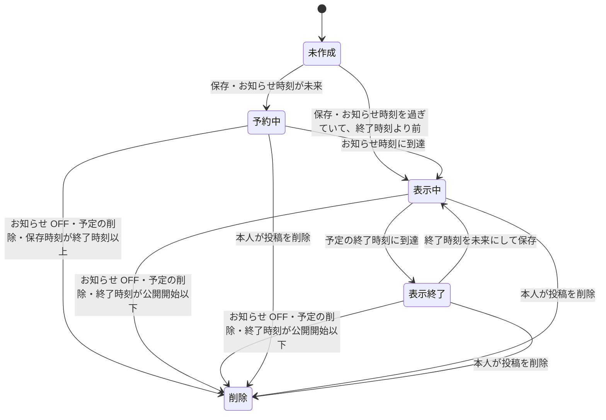

# 予定

キャストが営業日ごとの時間帯（予定）を登録する機能。
予定はキャストのプロフィールの予定タブと予定検索に表示され、お知らせ（投稿）を付けるとホームやフィードにも現れる。
登録・編集・削除を行えるのは、キャストのアカウントでログイン中のプロフィール本人だけ。
見る側はキャスト・ゲストの区別なく、有効なプロフィールでログインしていれば予定を閲覧できる。
ただし、ブロック関係にある場合と、鍵付きのキャストの鍵を通れない場合は、予定の一覧にも予定検索にも出ない。

## Rules

### 登録できるユーザー

| 状況 | 登録・編集・削除 |
| --- | --- |
| 本人（キャストの有効なプロフィールでログイン中） | できる。 対象は本人の予定のみ |
| 他人のプロフィール | できない。 対象のプロフィールを指定する入力はない |
| ログイン済みだが有効なプロフィールがない | できない（プロフィールの選択・作成を求められるエラー） |
| 未ログイン | できない（認証エラー） |
| ゲストのプロフィール | できない。 画面には予定タブが表示されず、サーバーも「キャストだけが予定を登録できます」（権限エラー）で拒否する |

### 予定の単位

- 1プロフィール × 1営業日 = 1行。
  - 同じ営業日に保存すると、時刻が上書きされる。
- 営業日は 05:00 から翌日 05:00 まで。
- 開始時刻が 05:00 以降なら、予定は営業日の当日に属する。
- 開始時刻が 00:00〜04:59 なら、予定は前夜（営業日の深夜）の続きとして扱う。
- 終了時刻が開始時刻以下（同時刻を含む）なら、終了は翌日の同じ時刻になる。
  - 同時刻は 24 時間の予定になる。
- 時刻は `HH:MM` 形式のみ受け付ける。
- 日付は、保存・削除・一覧のどれでも、実在する `YYYY-MM-DD` のみ受け付ける。
- 過去の日付にも登録できる。
  - 予定タブの表示と編集の対象は、端末のローカル日付の今日から翌月末まで。
  - 予定検索の対象は、日本時間の今日から翌月末まで。

### 入力の検証

| 項目 | 条件 | 不正な場合 |
| --- | --- | --- |
| 予定日 | 実在する `YYYY-MM-DD` | 「予定日の形式が正しくありません」 |
| 開始時刻・終了時刻 | `HH:MM`（00:00〜23:59） | 「開始時刻の形式が正しくありません」（終了時刻も同様） |
| お知らせ時刻 | お知らせ ON のときのみ検証。 `HH:MM` | 「お知らせの時刻の形式が正しくありません」 |
| お知らせ時刻と予定終了 | お知らせ時刻が予定の終了（実時刻）より前であること | 「お知らせの時刻は予定の終了より前にしてください」 |
| ひとこと | お知らせ ON のときのみ検証。 前後の空白（全角スペースなど Unicode の空白を含む）を除いて 200 文字以内。 空は可 | 「ひとことは200文字以内で入力してください」 |

お知らせ OFF のとき、お知らせ時刻とひとことは検証されず無視される。

### 予定の見え方

| 閲覧者 | 予定タブ（一覧） | 予定検索 | お知らせ投稿 |
| --- | --- | --- | --- |
| 本人 | 表示・編集できる | キャストであれば候補に含まれる | 表示される |
| 承認済みフォロワー | 表示される | 候補に含まれる。 お知らせ投稿を見られない場合、ひとこと欄は空になる | 公開範囲の規則に従う（[投稿](posts.md)） |
| 鍵のないキャストの、フォロー関係のない閲覧者と承認待ちの閲覧者 | 表示される | 候補に含まれる。 お知らせ投稿を見られない場合、ひとこと欄は空になる | 公開範囲の規則に従う（[投稿](posts.md)） |
| 鍵付きのキャストの、フォロー関係のない閲覧者と承認待ちの閲覧者 | 空になる。 画面は「フォローすると見られます」と伝える | 候補から除外される | 公開範囲の規則に従う（鍵は関係しない） |
| ブロック関係（どちらか一方向でも） | 空になる。 画面は案内を出さない | 候補から除外される | 表示されない |
| 無効化されたプロフィール・退会したアカウント | 空になる | 候補から除外される | 表示されない |

- 予定タブに並ぶ日は、本人と他の閲覧者で異なる。
  - 本人には今日から 14 日分が並び、予定のない日は「未設定」になる。
  - 本人には、15 日目から翌月末までの予定のある日も並ぶ。
  - 他の閲覧者には予定のある日だけが並ぶ。
  - 他の閲覧者に見せる予定が今日から翌月末までになければ、「予定はありません」と伝える。
- キャストは、作成メニューの「予定」から、どの画面でもまとめて編集の画面を開ける。
  - 開いたときは、どの日も選ばれていない。
- 本人は、予定タブから 2 つの方法で編集を始められる。
  - 「今日の予定」は、今日だけを選んだ状態で編集画面を開く。
  - 「まとめて編集」は、今日から翌月末までの日付を月ごとのカレンダーで選ぶ編集画面を開く。
- 鍵を通れるかどうかは [プロフィール](profiles.md) の規則で、閲覧者ごとに判定する。
- 鍵を通れない閲覧者にも、予定タブは表示する。
  - 開くと、内容の代わりに「フォローすると見られます」と伝える。
- 鍵はお知らせ投稿に効かない。
  - 公開範囲を「全員」にしたお知らせ投稿は、鍵付きのキャストでも見える。

## Lifecycle

### 予定の時刻と営業日（予定日 2026-10-24 の例）

| 入力（予定日・開始〜終了） | 開始（実時刻） | 終了（実時刻） |
| --- | --- | --- |
| 10:00〜18:00 | 10/24 10:00 | 10/24 18:00 |
| 20:00〜02:00 | 10/24 20:00 | 10/25 02:00 |
| 01:00〜05:00 | 10/25 01:00 | 10/25 05:00 |
| 22:00〜22:00 | 10/24 22:00 | 10/25 22:00 |

### お知らせ投稿の状態

- 本人以外に表示される期間は「公開開始 ≤ 現在 < 終了時刻」。
  - 本人には、予約中と表示終了の投稿も見える（[投稿](posts.md)）。
  - 公開開始は、お知らせ時刻と保存時刻のうち遅い方になる。
- お知らせ時刻は予定日の当日の時刻として扱う。
  - 開始が 00:00〜04:59 の予定でも、お知らせ時刻は予定日の当日になる。
- お知らせ時刻が予定の終了（実時刻）以上なら保存が拒否される。
  - 同日の予定（10:00〜18:00）では 17:59 は可、18:00 は不可。
  - 翌日に終わる予定では、どのお知らせ時刻も可。
- 保存時刻が終了時刻以上なら、お知らせ投稿は作られない（予定の行は保存される）。
- 予約中の投稿は、お知らせ ON で保存時刻が終了時刻以上なら削除される。
- 表示中の投稿を保存し直すと、公開開始は元の値を保つ。
  - 表示中の投稿の公開開始は、指定したお知らせ時刻に合わせて動かない。
  - ひとこと・終了時刻は更新される。
  - 更新後の終了時刻が公開開始以下になると、投稿は削除される。
- 終了後に保存し直すと、既存の投稿は作り直されず、保存の終了時刻で期限が更新される。
  - 公開開始は元の値を保つ。
  - 更新後の終了時刻が公開開始以下なら、投稿は削除される。
  - 更新後の終了時刻が未来なら、再び表示される。
- 終了時刻を過ぎた投稿は、本人以外には表示されなくなるが、投稿の行は残る。
  - 本人には「表示終了」の印付きで見える（[投稿](posts.md)）。
  - 表示終了の投稿を自動で消す処理はない。
- お知らせ OFF で保存すると、紐づくお知らせ投稿は削除される。
- 予定を削除すると、お知らせ投稿も削除される。
- 本人がお知らせ投稿を削除しても、予定の行は残る。
  - 次にお知らせ ON で保存すると、終了時刻を過ぎていなければ投稿を作り直す。
- 予定の行は時刻で自動削除されない。
  - 消えるのは、本人の削除操作またはプロフィールの完全削除のとき。

## Interactions

- お知らせ投稿は投稿として扱われ、公開範囲・ブロック・期限の規則は [投稿](posts.md) と同じ。
- ホームとフィードの並び順にはお知らせの公開開始時刻が使われる（[フィード・ランキング](feed-and-ranking.md)）。
- 予定検索の結果は [検索](search.md) で扱う。
- 予定の登録・編集は通知を作らない。
- プロフィールを削除すると予定の行が消え、お知らせ投稿も投稿の削除処理で消える（[プロフィール](profiles.md)）。
- プロフィールの無効化・アカウントの退会により、予定は一覧・検索・投稿のすべてから見えなくなる（[アカウント](account.md)、[プロフィール](profiles.md)）。
- ブロックは予定の一覧・予定検索・お知らせ投稿から相手を除外する（[フォロー・ブロック](follows-and-blocks.md)）。
- 鍵は予定の一覧と予定検索から、鍵を通れない閲覧者を除外する（[プロフィール](profiles.md)）。

## Data

- `schedule.schedules`: 予定の行（プロフィール × 営業日。お知らせ投稿との紐づけを持つ）
- `post.posts`: お知らせ投稿（公開開始・終了・ひとこと）
- `social.blocks`: 予定の一覧と予定検索からの除外判定
- `social.follows`: お知らせ投稿の承認済みフォロワー判定、予定の一覧と予定検索の鍵の判定、予定検索の「フォロー中だけ」
- `profile.profiles`: 予定の一覧と予定検索の鍵の判定

カラム詳細は [data model](../data-model.md) を参照。

## Rationale

- 営業日の区切りを 05:00 にしている。
  - 深夜の予定（00:00〜04:59 開始）を前夜の続きとして同じ営業日に束ねるため。
- お知らせは `post.posts` の行として持つ。
  - 公開範囲・ブロック・期限の規則を投稿と共通化するため。
- 鍵はお知らせ投稿に効かせない。
  - 公開範囲を「全員」にした投稿は、フォローしていない人にも見える公開投稿であり、鍵の対象（予定とクチコミ）に入らないため。
